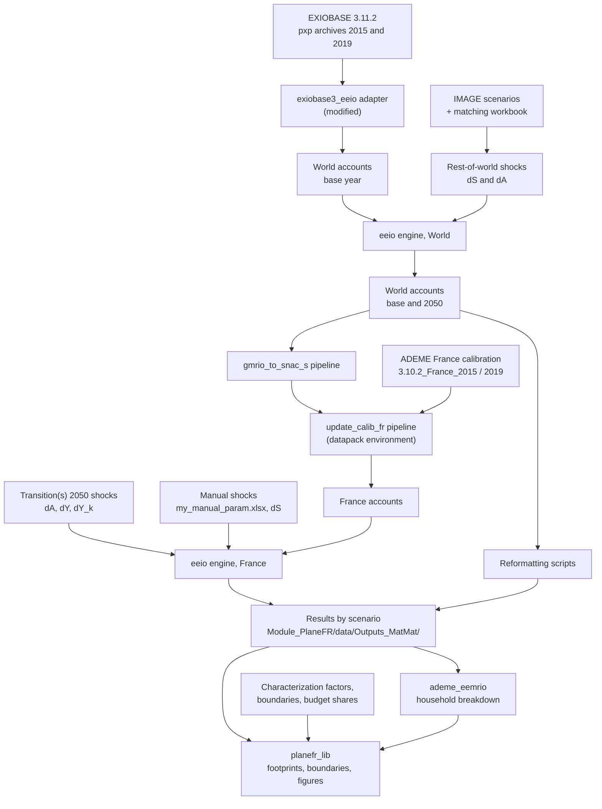

# PlaneFR module — technical reference documentation

This document describes the PlaneFR module, which assesses the environmental pressures of France against the planetary boundaries using the MatMat input-output model. 

It describes the state of the code on 20 November 2026.

## Contents

1. [What the module does](#1-what-the-module-does)
2. [Code and data layout](#2-code-and-data-layout)
3. [Installation and prerequisites](#3-installation-and-prerequisites)
4. [Changes to the MatMat source code](#4-changes-to-the-matmat-source-code)
5. [Computation chain in matmat-ademe](#5-computation-chain-in-matmat-ademe)
6. [Building the scenario shocks](#6-building-the-scenario-shocks)
7. [Post-processing and figures: Module_PlaneFR](#7-post-processing-and-figures-module_planefr)
8. [Breakdown by household category: ademe_eemrio](#8-breakdown-by-household-category-ademe_eemrio)
9. [Data and parameter files](#9-data-and-parameter-files)
10. [Summary of assumptions](#10-summary-of-assumptions)
11. [User guide](#11-user-guide)
12. [Glossary](#12-glossary)

---

## 1. What the module does

For France, the module computes the consumption footprint and the territorial pressures on nine planetary-boundary indicators, then compares them with a share of the global budget allocated to France. It does so for the base year and for scenarios to 2050.

The computation relies on three building blocks, spread over three repositories:

| Block | Repository | Role |
|---|---|---|
| Model | `matmat-ademe` (fork of MatMat) | Extracts the EXIOBASE accounts, builds the France accounts, applies the scenario shocks and computes the footprints. |
| Post-processing | `Module_PlaneFR` | Converts the EXIOBASE extensions into planetary-boundary indicators, compares them with the boundaries and produces the figures. |
| Households | `ademe_eemrio` | Splits the footprint between household categories, using the 2017 Budget de famille survey. |

### Indicators

The code distinguishes two levels, which helps when reading the scripts:

- the **extension** is the MatMat satellite account (`land`, `water`, `nutrients`…). In `planefr_lib` it is called `lp_name` and corresponds to the "EXIOBASE groups" column of `indicator_computing.xlsx`;
- the **Indicator** is what is shown in the figures ("N surplus", "GHG emissions"…), i.e. the "Indicators" column of `indicator_computing.xlsx` and a column of `boundaries_values.xlsx`. An indicator can aggregate several extensions.

| Indicator | Extensions used | Figure unit |
|---|---|---|
| GHG emissions | `ghg_emissions`, `ghg_combustion` | MtCO2eq |
| N surplus | `nutrients`, `air_emissions` | Gg |
| P surplus | `nutrients` | Gg |
| Blue water consumption | `water` | Md m³ |
| Cropland use | `land` | Md m² |
| Agricultural land | `land` | Md m² |
| Raw material consumption | `raw_materials` | Mt |
| Biodiversity loss - PDF | `air_emissions`, `ghg_emissions`, `ghg_combustion`, `land`, `nutrients`, `water` | Md PDF.m2.yr |
| Biodiversity loss - HANPP | `land`, `raw_materials` | MtC |

The `energy` and `deforestation` extensions are extracted and computed by the model, but no indicator uses them at present.

### Scenarios

| Name | Content | Scope of the shock |
|---|---|---|
| `Base_year_2015`, `Base_year_2019` | Base years, no shock | — |
| `S1_2050` to `S4_2050`, `TEND_2050` | ADEME Transition(s) 2050 scenarios and trend scenario | French economy |
| `SSP2_2050`, `SSP2_19_2050`, `SSP2_19_Sus_2050` | Scenarios of the IMAGE model | Rest of the world |
| `S1+` | S1 applied to accounts whose rest of the world follows `SSP2_19_Sus` | France and rest of the world |
| suffix `_agri` | Same scenarios, pressures restricted to the agri-food system | — |
| `2019_W`, `2019_EU27`, `2019_<code>` | World, EU27 and each of the 49 EXIOBASE regions in 2019 | — |

A 2050 France scenario therefore combines two independent choices: the French scenario (S1 to S4, TEND) and the state of the rest of the world (unchanged from the base year, or projected along an IMAGE scenario).

### Two accounting perspectives

- **CBA** (consumption-based accounting): pressures exerted anywhere in the world to meet French final demand. This is the footprint, the sum of a domestic part and an imported part.
- **PBA** (production-based accounting): pressures exerted on French territory, by production and directly by final demand.

---

## 2. Code and data layout

The links in this document and several paths in the code assume the following local tree:

```
Code/
├── MatMat/
│   ├── matmat-ademe/        fork of MatMat: modified source code, scripts, data, settings
│   └── datapack/            MatMat training environment (matmat 0.9.0b0 wheel)
├── Module_PlaneFR/          post-processing, parameter data, figures
└── Github/
    └── ademe_eemrio/        breakdown by household category
```

| Repository | Remote | Branch | Revision described |
|---|---|---|---|
| `matmat-ademe` | `Arnaud-destarac/matmat-ademe`, fork of `AntoineTeixeira/matmat-ademe` | `main` | `9dd8c7d`, derived from upstream commit `bce703f` (MatMat 0.9.0-beta)
| `Module_PlaneFR` | `Arnaud-destarac/PlaneFR` | `main` | `2c6267e1`
| `ademe_eemrio` | `CIRED/ademe_eemrio` | `ademe_eemrio_dev` | `5319dd4`


### Overall flow



### Where the files are

In `matmat-ademe`, everything specific to PlaneFR is in the `planeFR/` folder, which is versioned: the pipeline scripts and their parameters. The data, accounts and outputs stay in `data/4-PlaneFR/`, which is excluded from git like the whole `data/` folder (`**/data/` in `.gitignore`).

```
matmat-ademe/
├── planeFR/                  versioned
│   ├── scripts/              pipeline scripts (Python), one folder per chain
│   │   ├── planefr.py            the pipeline command (chains and MatMat batch steps)
│   │   ├── _common/              shared paths, settings templates and helpers
│   │   ├── base_accounts/        extract_f_y_tot.py: F_Y extraction
│   │   ├── france_shocks/        export_dS.py, compute_ds_x_dom.py: manual shocks on French domestic pressures
│   │   ├── ssp_shocks/           extract_S_SSPs.py, generate_shock_dS.py: rest-of-world shocks from IMAGE
│   │   ├── agri_shocks/          generate_shock_agri.py: agri-food variants of the shocks
│   │   ├── outputs/              reformat_d_cba_monde_europe.py, reformat_d_cba_k.py, build_scenario_groups.py
│   │   └── tests/                tests of the pipeline command (pytest)
│   ├── parameters/           settings templates, bridge matrices, manual shocks
│   │   ├── 1-exiobase3_eeio/ … 4-engine/   templates and bridges of each MatMat step
│   │   └── a-manual_shocks/      my_manual_param.xlsx
│   └── .gitignore
└── data/4-PlaneFR/           not versioned
    ├── 1-accounts/
    ├── 2-shocks/
    ├── Outputs/
    ├── Outputs_inter/
    └── Settings_run/         settings files generated at each run
```

| Location | Content | Versioned |
|---|---|---|
| `matmat-ademe/src/matmat/` | MatMat source code, including the five modified files | yes |
| `matmat-ademe/planeFR/scripts/` | Python scripts of the PlaneFR pipeline, in one folder per chain, the `planefr.py` command that chains them, and its tests | yes |
| `matmat-ademe/planeFR/parameters/` | Settings templates (JSON), bridge matrices, manual shocks | yes |
| `matmat-ademe/data/01-sources_public/exiobase/<version>/` | EXIOBASE archives `IOT_<year>_pxp.zip` | no |
| `matmat-ademe/data/4-PlaneFR/Settings_run/` | Settings files generated from the templates at each run | no |
| `matmat-ademe/data/4-PlaneFR/1-accounts/` | EXIOBASE accounts in MatMat format | no |
| `matmat-ademe/data/4-PlaneFR/2-shocks/` | Scenario shocks | no |
| `matmat-ademe/data/4-PlaneFR/Outputs/`, `Outputs_inter/` | Computed accounts (World, France) and intermediate outputs | no |
| `Module_PlaneFR/data/Boundaries/` | Planetary boundaries (`boundaries_values.xlsx`), budget shares (`budget_shares.xlsx`, `budget_shares.py`) and their sources (`input_data/`) | yes |
| `Module_PlaneFR/data/Input_Shocks_MatMat/` | Inputs of the shocks: `Matching_EXIOBASE_IMAGE.xlsx`, `S_extraction.xlsx`, IMAGE scenarios and `Nutrients.xlsx` (`input_data/`) | yes |
| `Module_PlaneFR/data/Outputs_MatMat/` | Model results by scenario (`<version>/`), `scenario_groups.json` | yes |
| `Module_PlaneFR/data/Post_processing/` | `indicator_computing.xlsx`, `bridge_matrices.xlsx`, `add_biodiversity_rows.py` and its source (`input_data/`) | yes |
| `Module_PlaneFR/notebooks/planefr_lib/` | Post-processing library | yes |
| `Module_PlaneFR/notebooks/*.ipynb` | Figure notebooks | yes |
| `Module_PlaneFR/notebooks/biodiversity_process_contribution.py` | Script of the `biodiversity_process_contribution` figures | yes |
| `Module_PlaneFR/figures/` | Figures and the Excel workbooks of their data, one sub-folder per notebook (§ 7.5) | yes |
| `Module_PlaneFR/docs/` | This documentation | yes |
| `Module_PlaneFR/Archives/BdF/` | Older versions of `BdF.ps1`, `export_impacts_coicop.py`, `agregation_impacts_facteurs.py`; the versions in use are those of `ademe_eemrio` (§ 8) | yes |


> **Possible improvement** `Module_PlaneFR` versions its model results (`data/Outputs_MatMat/3.11.2/`, about 8,800 pickles), which can all be regenerated. Git handles large binary files poorly: the repository grows at each run. Git LFS, or publishing the results separately (e.g. on Zenodo, as MatMat does), would keep it light.

---

## 3. Installation and prerequisites

The project uses four Python environments, because the repositories do not have the same dependencies.

| Environment | Python | Key dependencies | Used for |
|---|---|---|---|
| `matmat-ademe/.venv` (managed by `uv`) | 3.11 | pandas 2.2.2, pymrio 0.5.4, scipy 1.17.1 | Adapter, `gmrio_to_snac_s` pipeline, engine, Python pipeline scripts |
| `datapack/.venv` (managed by `uv`) | 3.11 | wheel `matmat-0.9.0b0`, pandas 2.2.2 | `update_calib_fr` pipeline only |
| Module_PlaneFR (`requirements.txt`) | 3.14 | pandas 3.0.1, matplotlib 3.10.8, pymrio 0.6.3, country_converter 1.3.2 | Notebooks, `planefr_lib`, `data/Boundaries/budget_shares.py` |
| ademe_eemrio (`py -3` launcher) | 3.x | pandas, openpyxl, jupyter, nbconvert | "Budget des familles" chain |

The `update_calib_fr` pipeline does not exist in the public `matmat-ademe` repository: its `src/matmat/workflows/pipelines/accounts/` folder only contains `aggregation` and `gmrio_to_snac_s`. It is only available in the `matmat-0.9.0b0` wheel shipped with the `datapack`. The scripts therefore run this step from the `datapack` folder, while reading the settings of `matmat-ademe`.

The pandas version gap between environments has a practical consequence: a pickle written with pandas 3 cannot be read with pandas 2 when it contains strings of type `StringDtype`. § 4.4 describes the fix.

> **Possible improvement** Porting `update_calib_fr` into `matmat-ademe` would remove the detour through the `datapack` environment, and aligning the pandas versions of `matmat-ademe` and `Module_PlaneFR` would make the pickle workaround of § 4.4 unnecessary. The pipeline would then run in one environment.

### Configuration

Both `config.toml` files (`matmat-ademe` and `datapack`) must point to the same data folder, that of `matmat-ademe`:

```toml
[run]
data_dir = "C:/Users/<user>/.../Code/MatMat/matmat-ademe/data"
settings_dir = "C:/Users/<user>/.../Code/MatMat/matmat-ademe/settings"
```

All relative paths in the JSON settings (`./4-PlaneFR/...`) are resolved against `data_dir`. The templates may use either separator: `planefr.py` writes the generated settings with `/`, which works on Windows and Linux.

### Paths

The pipeline scripts contain no path specific to a machine, so the repository works for anyone who clones it. All the paths are fixed relative to the repository. The scripts take them from [planeFR/scripts/_common/planefr_paths.py](../../MatMat/matmat-ademe/planeFR/scripts/_common/planefr_paths.py), which derives them from its own location; the pipeline command reads them through `planefr_settings.Layout.default()`:

| Constant | Value |
|---|---|
| `PLANEFR_DIR`, `MATMAT_DIR` | `matmat-ademe/planeFR/`, `matmat-ademe/` |
| `PARAMETERS_DIR` | `matmat-ademe/planeFR/parameters/` |
| `MATMAT_DATA_DIR`, `PLANEFR_DATA_DIR` | `matmat-ademe/data/`, `matmat-ademe/data/4-PlaneFR/` |
| `MODULE_PLANEFR_DIR` | `<root>/Module_PlaneFR/`, or the `PLANEFR_MODULE_DIR` environment variable |
| `MODULE_INPUT_SHOCKS_DIR`, `MODULE_OUTPUTS_DIR`, `MODULE_POST_PROCESSING_DIR` | `Module_PlaneFR/data/Input_Shocks_MatMat/`, `.../Outputs_MatMat/`, `.../Post_processing/` |
| `DATA_VERSION_DIR` | `Module_PlaneFR/data/Outputs_MatMat/<PLANEFR_EXIOBASE_VERSION>/` |

The only files holding machine-specific absolute paths are the two `config.toml` files (`data_dir`, `settings_dir`), which are local by design, and the settings files generated in `data/4-PlaneFR/Settings_run/` at each run.

Each Python script of a chain folder adds `_common` to its import path (`sys.path.insert(0, str(Path(__file__).resolve().parents[1] / "_common"))`), then imports `planefr_paths` and, if needed, `planefr_utils` (`make_pickle_portable`). `planefr_paths.get_ssp_base_accounts_dir()` gives the base accounts of the SSP shocks (§ 5.3). The pipeline command `planefr.py`, at the root of `planeFR/scripts/`, imports `_common/planefr_settings.py` the same way (`Path(__file__).resolve().parent / "_common"`), and runs the other scripts by their path relative to `planeFR/scripts/`.

`planefr_lib`, `data/Boundaries/budget_shares.py` and `ademe_eemrio` only use relative paths too, and assume the same tree of § 2: `planefr_lib.config.BDF_FILE` looks in `../Github/ademe_eemrio/`, and `export_impacts_coicop.py` looks in `../../Module_PlaneFR/notebooks`.

### Environment variables

| Variable | Default | Effect |
|---|---|---|
| `PLANEFR_MODULE_DIR` | `<root>/Module_PlaneFR` | Location of `Module_PlaneFR`, if it is not next to the `MatMat` folder. Read by `_common/planefr_paths.py`. |
| `PLANEFR_EXIOBASE_VERSION` | `3.11.2` | EXIOBASE version read by the Python pipeline scripts and by `planefr_lib.config`. Set by `planefr.py` from its `--version` option. |
| `PLANEFR_SCENARIO_GROUP` | `no_SSP` | Scenario group read by default by `planefr_lib`. |
| `PLANEFR_FIGURES_DIR` | `Module_PlaneFR/figures` | Root folder of the figures (one sub-folder per notebook, `config.figure_dir`). Useful to test a notebook without overwriting the existing figures. |
| `PLANEFR_SCENARIO` | `2050_raw/SSP2_19_Sus_2050/S1_2050` | Scenario processed by `export_impacts_coicop.py`, relative to `Outputs_MatMat/<version>/`. Set by `BdF.ps1` (`<group>/<name>`). |

---

## 4. Changes to the MatMat source code

Compared with upstream commit `bce703f`, five files of the `matmat` package are modified. The changes concern the EXIOBASE adapter and the pickle export. The `eeio` engine, the `gmrio_to_snac_s` pipeline and the computation core are not modified.

| File | Change |
|---|---|
| [exiobase3_eeio/core.py](../../MatMat/matmat-ademe/src/matmat/workflows/adapters/accounts/exiobase3_eeio/core.py) | Generic extraction of extensions, `all` keyword, EXIOBASE 3.11.2 support, deterministic extension order |
| [exiobase3_eeio/extractor.py](../../MatMat/matmat-ademe/src/matmat/workflows/adapters/accounts/exiobase3_eeio/extractor.py) | Six specialized extractors replaced by a "pass-through" extractor |
| [exiobase3_eeio/settings.json](../../MatMat/matmat-ademe/src/matmat/workflows/adapters/accounts/exiobase3_eeio/settings.json) | Example settings updated with the new extension names |
| [utils/constants/domain.py](../../MatMat/matmat-ademe/src/matmat/utils/constants/domain.py) | Six extension-name constants removed |
| [utils/formats/core.py](../../MatMat/matmat-ademe/src/matmat/utils/formats/core.py) | Pickles portable across pandas versions |

The fork also adds the `scripts/` folder (§ 5) and training and development notebooks in `notebooks/`, which are not part of the module.

### 4.1 Generic extraction of EXIOBASE extensions

**Before.** The adapter mapped each MatMat extension to a dedicated extraction class (`EXTRACTOR_MAP`, eight entries). Each class filtered the rows of EXIOBASE's merged satellite account with its own rule: label containing "Water", unit equal to "km2", prefix "N - "… Adding an extension required writing a class, and these filters depended on the labels of a given EXIOBASE version.

**After.** Only two extensions keep a dedicated extractor, because they need real processing (conversion to CO2 equivalent, grouping of materials):

```python
# Exiobase3EEIO, core.py
CUSTOM_EXTRACTORS = {
    cst.GHG_EMISSIONS: cls_extractor.GreenhouseGasEmissionsExtractor,
    cst.RAW_MATERIALS: cls_extractor.RawMaterialsExtractor,
}
KEY_ALL_EXTENSIONS = "all"
```

Any other requested extension is the EXIOBASE satellite account of the same name, taken as is by `PassthroughExtractor`:

```python
# extractor.py
class PassthroughExtractor(ExtensionExtractor):
    def __init__(self, extensions: pymrio.Extension, extension_name: str):
        super().__init__(extensions)
        self._extension_name = extension_name

    def extract(self) -> pymrio.Extension:
        extension_out = copy.deepcopy(self._extensions)
        extension_out.name = self._extension_name
        return extension_out
```

Three behavioural changes follow.

1. **Name validation is deferred.** The available satellite accounts are only known once the archive has been read. `_validate_extensions()`, called in the constructor, is replaced by `_resolve_extension_names()`, called at the start of `process()`. Valid names are the two custom extensions and every account returned by `accounts.get_extensions()`. An invalid name raises a `ValueError` listing the names available in the loaded version.
2. **Raw accounts are set aside before merging.** `_concat_extension_in_pymrio_format()` merges all satellite accounts into one, which the custom extractors need. The requested raw accounts are therefore copied beforehand into `self._raw_extensions`, and their index is renamed `extension_category`.
3. **The `["all"]` keyword** in `extension_names` extracts the two custom extensions and every satellite account of the archive.

As a result, the same pressure can appear in two extensions: the custom extractors filter the merged account, which also contains the rows of the pass-through accounts. Agricultural nitrous oxide, for example, appears both in `ghg_emissions` and in `air_emissions`. This overlap causes no double counting as long as no indicator takes the same pressure from two extensions. That is the case with the current characterization factors: "Biodiversity loss - PDF", which uses both `ghg_emissions` and `air_emissions`, takes no greenhouse gas from `air_emissions`.

Example settings used by the project:

```json
{
  "path_in": ".\\01-sources_public\\exiobase",
  "path_out": ".\\4-PlaneFR\\1-accounts\\Exiobase\\3.11.2_2019",
  "export_format": ["pickle"],
  "version": "3.11.2",
  "system": "pxp",
  "base_year": 2019,
  "extension_names": ["nutrients", "deforestation", "energy", "ghg_emissions",
                      "land", "raw_materials", "water", "air_emissions"],
  "clean_path_out": true
}
```

### 4.2 Extension names changed

Pass-through extensions now carry the name of the EXIOBASE satellite account. The constants `LABOR`, `VALUE_ADDED`, `WATER`, `LAND_USE`, `BIOGEOCHEMICAL` and `ENERGY` of `domain.py` are removed.

| Former MatMat name | New name |
|---|---|
| `labor` | `employment` |
| `value_added` | `factor_inputs` |
| `land_use` | `land` |
| `biogeochemical` | `nutrients` |
| `water`, `energy` | unchanged |

This change is incompatible with settings, bridge matrices and shocks written with the old names.

The content of the extensions changes too. `water` now contains the whole `water` satellite account of EXIOBASE, not only the rows whose label contains "Water". `land` is no longer defined by the "km2" unit.

### 4.3 EXIOBASE 3.11.2 and deterministic order

Version `3.11.2` is added to `SUPPORTED_VERSIONS_TO_DOI` (DOI `10.5281/zenodo.23039074`).

The satellite accounts are now merged in alphabetical order of their name:

```python
extensions = pymrio.concate_extension(
    [getattr(accounts, ext) for ext in sorted(accounts.get_extensions())],
    name=cst.KEY_EXTENSIONS,
)
```

pymrio loads the satellite accounts from a `set`. Without this sort, the row order of the merged account varied from one run to the next.

### 4.4 Pickles portable across pandas versions

`PickleFormat.export()` now casts any `StringDtype` data, in values, index and columns, to `object` before writing:

```python
def export(self, df: pd.DataFrame, path: str, file_name: str):
    df = self._make_pickle_portable(df)
    df.to_pickle(f"{os.path.join(path, file_name)}.{self.EXTENSION}")
```

The serialized form of `StringDtype` is not stable across pandas versions. Since pandas 3.0, strings get this type by default, and a pickle written that way cannot be read with pandas 2.x. Yet the shocks are produced by scripts that may run under pandas 3, then read by the engine under pandas 2.2.2.

The same function is duplicated as `make_pickle_portable` in `planeFR/scripts/_common/planefr_utils.py`, for the scripts that write pickles without going through `PickleFormat`. The scripts could import the MatMat version instead.

### 4.5 Integration work left

Several pipeline scripts repair or complete MatMat outputs after the fact. Moving these treatments into MatMat would make PlaneFR a module of the model rather than a layer on top of it.

| Script | What it works around | Where it would belong |
|---|---|---|
| `extract_f_y_tot.py` | `F_Y` is not part of the accounts written by the adapter; the script replays the adapter by calling its private methods (`_resolve_extension_names`, `_raw_extensions`) | Export of `F_Y` by the `exiobase3_eeio` adapter |
| `reformat_d_cba_monde_europe.py` | Single-level MultiIndex left by `cast_index_to_multiindex()`; World, EU27 and regional aggregates | Index fix in the extraction; aggregation pipeline of MatMat |
| `reformat_d_cba_k.py` | Different formats of the GHG and raw-material extensions of the France calibration | Harmonization of the calibration extensions in `update_calib_fr` |
| `update_calib_fr*` steps of `planefr.py` | `update_calib_fr` only exists in the `datapack` wheel | Port of the pipeline to `matmat-ademe` (§ 3) |

---

## 5. Computation chain in matmat-ademe

The pipeline is driven by a single Python command, [planeFR/scripts/planefr.py](../../MatMat/matmat-ademe/planeFR/scripts/planefr.py), which prepares a settings file for each MatMat run, then calls the MatMat command line (`uv run python -m matmat.cli`) or one of the Python scripts of [matmat-ademe/planeFR/scripts/](../../MatMat/matmat-ademe/planeFR/scripts/). It only depends on the standard library and runs on Windows and Linux. Its sub-commands are the chains of § 5.1 and `step <name>`, which runs a single MatMat batch step:

| Step (`planefr.py step <name>`) | Processing | `--suffix` |
|---|---|---|
| `exiobase3_eeio` | `exiobase3_eeio` adapter, then World `eeio` engine, for 2015 and 2019 | no |
| `gmrio_to_snac_s` | `gmrio_to_snac_s` for 2015 and 2019 | no |
| `update_calib_fr` | `update_calib_fr` for 2015 and 2019 (from `datapack`) | no |
| `engine` | France `eeio` engine, all groups | yes |
| `engine_no_ssp` | France `eeio` engine, `no_SSP` group only | yes |
| `engine_ssps` | World `eeio` engine on the SSP shocks | yes |
| `gmrio_to_snac_s_ssps` | `gmrio_to_snac_s` on each projected world, then copy of the reference `F_x_dom` (`--reference`) | yes |
| `update_calib_fr_ssps` | `update_calib_fr` on each projected world (from `datapack`) | yes |

**Settings templates.** The JSON files of `planeFR/parameters/` are templates: the pipeline never modifies them. For each run, a step reads a template (`read_template`), sets the paths of that run (accounts, shock, output), then writes the result under `data/4-PlaneFR/Settings_run/`, with the same relative path (`write_run_settings`). That generated file is passed to `matmat.cli`. Both functions, and the path helpers (`set_year_in_path`, `add_suffix`...), are in [_common/planefr_settings.py](../../MatMat/matmat-ademe/planeFR/scripts/_common/planefr_settings.py).

In the templates, the token `{parameters}` stands for the `planeFR/parameters/` folder, e.g. `"bridges": "{parameters}\\2-gmrio_to_snac_s\\bridge_matrices.xlsx"`. It is replaced by the absolute path of that folder in the generated file. The other paths of the templates (accounts, shocks, outputs) remain relative to the `data_dir` of `config.toml`, as MatMat expects: both MatMat versions resolve them with `Path(data_dir).joinpath(value)`. The paths of the generated files use `/` separators, whatever those of the template, so that this resolution also works on Linux.

To change a calculation parameter, such as `m_row_mode` or the list of extensions, edit the template: the next runs use it. The paths of accounts, shocks and outputs in the templates are only examples or starting points, overwritten by the pipeline.

**Tests.** [planeFR/scripts/tests/test_planefr.py](../../MatMat/matmat-ademe/planeFR/scripts/tests/test_planefr.py) checks the generated settings, the order of the runs, the copies and the chaining of the stages, without running MatMat: `planefr.py` sends its commands to a *runner*, replaced in the tests by one that records them. From the root of `matmat-ademe`: `uv run pytest planeFR/scripts/tests`.

### 5.1 Chains

Two chains each regenerate one set of shocks; a third computes all the output groups from the current shocks.

| Command | When to run it | Stages | Prerequisites |
|---|---|---|---|
| `planefr.py france-shocks` | After a change to the French shocks: `my_manual_param.xlsx`, system shocks of `1-transitions_2050` | Steps 3 (`no_SSP` group only), 5 to 8 of § 5.2 | Base accounts |
| `planefr.py ssp-shocks` | After a change to the SSP shocks: IMAGE scenarios, matching workbook, base year of the SSP shocks | § 5.3: shocks, then the rest of the world projected on them | Base accounts |
| `planefr.py outputs` | To compute all the output groups (`no_SSP`, `<SSP>_2050`...) from the current shocks | § 5.4 | Both shock chains run at least once |
| `planefr.py agri` | Agri-food variant of `outputs` | § 5.4: `_agri` shocks, rest of the world projected on them, 2019 agri geographies (`regions_agri`), then the `outputs` stages with the `_agri` suffix | Same as `outputs` |

After a change, run the shock chain(s) concerned, then `outputs` (and `agri` if needed). The simplest is to say what has changed; `planefr.py` then runs the matching chains:

| Option | What has changed | Chains run |
|---|---|---|
| `--All` | EXIOBASE version, France calibration, or everything | Base accounts (steps 0, 1, 2 and 4 of § 5.2), then `france-shocks`, `ssp-shocks` and `outputs` |
| `--RoW_shocks_change` | SSP shocks: IMAGE scenarios, matching workbook, base year of the SSP shocks | `ssp-shocks`, then `outputs --ssps` |
| `--France_shocks_change` | System shocks of `1-transitions_2050` | `france-shocks`, then `outputs` |
| `--France_shocks_dS_change` | `my_manual_param.xlsx` only | `france-shocks --manual-only`, then `outputs` |
| `--Agri` | Agri-food variant wanted, from the current France and SSP shocks | `agri`: `_agri` shocks, rest of the world projected on them, 2019 agri geographies (`regions_agri`), then the `outputs` stages with the `_agri` suffix |

These options also take `--version`. `--Agri` alone reads the current shocks. To also update the agri-food variant after a change, combine it with the matching option rather than running both one after the other: only the `_agri` part affected by the change is recomputed, and the post-processing (reformat scripts, `F_Y_tot` shocks, display groups) runs once for both variants.

| Combination | Chains run |
|---|---|
| `--France_shocks_change --Agri` | `france-shocks`; `generate_shock_agri.py --only transitions` (`3-SSPs_2050_agri` and the `_agri` projected world, which only depend on the SSP shocks, are kept); `regions_agri`; France engine, then France engine `_agri`; post-processing |
| `--France_shocks_dS_change --Agri` | Same, with `france-shocks --manual-only` |
| `--RoW_shocks_change --Agri` | `ssp-shocks`; `generate_shock_agri.py --only ssps`; rest of the world projected on the `_agri` SSP shocks; `regions_agri`; both France engines on the SSP groups only; post-processing |
| `--All --Agri` | Base accounts, `france-shocks`, `ssp-shocks`; `generate_shock_agri.py`; `_agri` projected world; `regions_agri`; France engine `_agri`; post-processing |

**Selecting the outputs.** `--France` and `--RoW` restrict the final France engine to some outputs; they apply to `outputs`, `agri` and the options above. Names are those of the scenarios, without the `_agri` suffix, and the pairs generated are the combinations of both lists: `--France S1_2050 --RoW no_SSP SSP2_2050` gives `no_SSP/S1_2050` and `SSP2_2050/S1_2050`. An omitted option means all the scenarios. `planefr.py --help` lists the existing French scenarios (folders of `2-shocks/1-transitions_2050`) and RoW scenarios (`no_SSP` and the folders of `2-shocks/3-SSPs_2050`). Notes:

- the baselines `Base_year_2015` and `2019_FR` are not recomputed, and the other groups receive the `2050_raw/no_SSP/Base_year_2015` of a previous run;
- the engine run of `france-shocks` (`no_SSP`, read by `export_dS.py`) is never restricted;
- the post-processing still processes every folder; an unknown name stops the engine and the error lists the available ones.

The change options can also be combined with each other. After a change to both the French and the SSP shocks, `--France_shocks_change --RoW_shocks_change` (or `--France_shocks_dS_change --RoW_shocks_change`) runs each shock chain once, then a single France engine pass on every group and a single post-processing: it is `--All` without the base accounts. `--Agri` can be added; both `_agri` shock sets and the `_agri` projected world are then rebuilt. `--France_shocks_change` includes `--France_shocks_dS_change`. The base accounts only depend on EXIOBASE and the France calibration: only `--All` rebuilds them.

All take `--version` (EXIOBASE version, `3.11.2` by default). Each chain stops at the first failing stage. A batch step processes all its runs even when one fails, so that all the failures are reported at once, then fails if at least one run failed: the chain then stops. A missing input folder is a failure too.

### 5.2 Base accounts and French shocks: `--All`, `france-shocks`

| Step | Folder | Script or step | Processing | Output (under `data/4-PlaneFR/` unless stated) | Chain |
|---|---|---|---|---|---|
| 0 | `1-exiobase3_eeio` | step `exiobase3_eeio` | `exiobase3_eeio` adapter for 2015 and 2019, then `eeio` engine on the world accounts | `1-accounts/Exiobase/<v>_<year>/` then `Outputs/World/Base_year_<year>/` | `--All` |
| 1 | `2-gmrio_to_snac_s` | step `gmrio_to_snac_s` | `gmrio_to_snac_s` pipeline: France accounts in SNAC format, imports separated | `Outputs_inter/gmrio_to_snac_s/<v>_pxp_<year>/` | `--All` |
| 2 | `3-update_calib_fr` | step `update_calib_fr` | `update_calib_fr` pipeline: adds the new extensions to the France calibration | `Outputs/France/Base_year_<year>/` | `--All` |
| 3 | `4-engine` | step `engine_no_ssp` (`france-shocks`), `engine` (`outputs`) | France `eeio` engine: base years, then one run per accounts × scenario pair | `Module_PlaneFR/data/Outputs_MatMat/<v>/...` | `france-shocks`, `outputs` |
| 4 | `base_accounts` | `extract_f_y_tot.py` | Direct pressures of final demand, by region | `Outputs/World/Base_year_<year>/extensions/<ext>/F_Y_tot.pkl` | `--All` |
| 5 | `outputs` | `reformat_d_cba_monde_europe.py` | World, EU27 and regional aggregates; France `F_Y_tot` | `Module_PlaneFR/data/Outputs_MatMat/<v>/2019_raw/2019_*/` and every France scenario | `france-shocks`, `outputs` |
| 6 | `outputs` | `reformat_d_cba_k.py` | Harmonizes the format of the GHG and materials extensions | Files rewritten in place | `france-shocks`, `outputs` |
| 7 | `france_shocks` | `export_dS.py` | Exports the base-year production and pressures | `Module_PlaneFR/data/Input_Shocks_MatMat/S_extraction.xlsx` | `france-shocks` |
| 8 | `france_shocks` | `compute_ds_x_dom.py` | Computes the manual intensity shocks, writes the extension folders of the shocks, and applies the `F_Y_tot` shocks | `2-shocks/1-transitions_2050/<scenario>/extensions/dom_<ext>/` (`dS_x_dom.pkl`, `detail_levels.xlsx`, `info.json`), `F_Y_tot.pkl` of every scenario | `france-shocks` (`--only-f-y-tot` in `outputs`) |

The "Folder" column gives the folder of `planeFR/parameters/` holding the settings template of a MatMat step, or the folder of `planeFR/scripts/` holding a Python script.

Steps 0, 1, 2 and 4 are the base accounts: they only depend on EXIOBASE and the France calibration, and only `--All` reruns them.

**A single engine pass for the French shocks.** Step 8 needs the production of the 2050 scenarios, an output of the engine (step 3), which must itself apply the intensity shocks of step 8. `france-shocks` therefore runs the engine on the `no_SSP` group only (`Base_year_2015` and the French scenarios), the only runs read by `export_dS.py`, then computes the `dS_x_dom`. This single pass gives exact shocks: production depends on the shocks to the production system (`dA`, `dY`, `dY_k`), not on the intensity shocks, so it does not matter which `dS_x_dom` the engine applied. `outputs` then runs the engine on every group with these `dS_x_dom`.

**`--manual-only`.** When only `my_manual_param.xlsx` has changed (not the system shocks, the accounts or the version), the production `x` and `S_extraction.xlsx` are still valid: `planefr.py france-shocks --manual-only` only runs `compute_ds_x_dom.py`. If in doubt, run it without the option.

`compute_ds_x_dom.py` deletes a `dS_x_dom` that has become entirely zero (shocks reset to 0 or emptied), and those of extensions that no longer have a sheet in `my_manual_param.xlsx`, so that the engine never applies an outdated shock.

#### Step 0 — EXIOBASE extraction and world accounts

The adapter reads the `IOT_<year>_pxp.zip` archive (product by product, 49 regions, 200 products) and writes MatMat accounts. The `eeio` engine, with the `standard` strategy and no shock (`settings_engine_World.json`), then computes for each extension the intensities `S_x_dom`, the multipliers `M` and the footprint `d_cba` of each region.

#### Step 1 — conversion to SNAC format

The `gmrio_to_snac_s` pipeline, unmodified, turns the world accounts into single-country accounts. The bridge matrix `planeFR/parameters/2-gmrio_to_snac_s/bridge_matrices.xlsx` defines France as the domestic region and aggregates the 48 other regions into one "import" origin.

Each extension is split in two: `dom_<ext>` holds the pressures exerted in France, `imp_<ext>` holds the pressure content of imports (`M_RoW`). This content is computed with the `foreign_global_feedback` mode: the full world production system is used, but the direct pressures of France are set to zero. The trade loops between France and the rest of the world are thus taken into account without counting domestic pressures twice.

The `calculate_accounts` option is `false`: the accounts are computed at the next step.

**Extension folders of the shocks.** The `1-transitions_2050` shocks were delivered with a production system at the resolution of the France calibration, without extension folders. There is no separate step to build them any more (the former `rebuild_shock_extensions.py` has been removed): `compute_ds_x_dom.py` (step 8) writes, next to each `dS_x_dom`, the two files the engine needs to load it: `detail_levels.xlsx`, copied from the France accounts the engine shocks (`Outputs/France/Base_year_2015/extensions/dom_<ext>/`, written by step 2), and `info.json`, that of the scenario's system plus `extension_name`. Only the extensions with a non-zero `dS_x_dom` get a folder; the engine skips the others.

#### Step 2 — merging with the France calibration

The `update_calib_fr` pipeline starts from the France accounts calibrated by ADEME, read in `data/3-workshops/1-accounts/MatMat/3.10.2_France_<year>/`, and adds to them the extensions computed at step 1. The production system remains that of the France calibration.

| Origin | Extensions |
|---|---|
| France calibration (`older_accounts`) | `dom_ghg_emissions`, `dom_ghg_combustion`, `dom_raw_materials` |
| EXIOBASE via `gmrio_to_snac_s` (`newer_accounts`) | `dom_` and `imp_` for `water`, `energy`, `land`, `nutrients`, `air_emissions`, `deforestation`; `imp_ghg_emissions`, `imp_raw_materials` |

The new extensions are brought to the resolution of the France calibration by `planeFR/parameters/3-update_calib_fr/bridge_matrices.xlsx`. When an extension exists in both sets of accounts, the pipeline keeps that of the France calibration.

The France calibration carries version number 3.10.2 and the new extensions version number 3.11.2: when `--version` changes, the step only changes the `newer_accounts` path.

#### Step 3 — France engine

The `engine` step runs the `eeio` engine with the `exo_invest_matrix` strategy, which endogenizes capital: gross fixed capital formation is no longer a final demand, it is allocated to the products that use it. With this strategy, only `A`, `Y` and `Y_k` can be shocked on the system side.

The `engine` step (chain `outputs`) runs:

1. the two base years, without shock;
2. one run for each accounts folder of `Outputs/France/` (except 2019) combined with each scenario of `2-shocks/1-transitions_2050/`.

The `engine_no_ssp` step (chain `france-shocks`) only runs the 2015 base year and the `Base_year_2015` accounts combined with each scenario, i.e. the `no_SSP` group.

The engine applies each shock relatively, `W = W0 × (1 + dW)`, then recomputes the accounts.

The outputs are stored by year (`2019_raw/`, `2050_raw/`) and, for 2050, by **group**, according to the accounts used:

| France accounts | Output folder in `Module_PlaneFR/data/Outputs_MatMat/<v>/` |
|---|---|
| `Base_year_2019`, no shock | `2019_raw/2019_FR/` |
| `Base_year_2015`, no shock | `2050_raw/no_SSP/Base_year_2015/` |
| `Base_year_2015` × scenario | `2050_raw/no_SSP/<scenario>/` |
| `<SSP>_2050` × scenario | `2050_raw/<SSP>_2050/<scenario>/` |

The 2015 base year is copied into each group, where it serves as the reference of the figures.

#### Step 4 — direct pressures of final demand

The direct pressures of final demand (`F_Y`: household water use, artificial surfaces…) are not part of the data model produced by the adapter, which only copies `F` and the units. `extract_f_y_tot.py` therefore replays the loading steps of the adapter and extracts `F_Y` for each extension:

- for a pass-through extension, it reads `F_Y` in the raw satellite account;
- for a custom extension, it substitutes `F_Y` for `F` before calling the extractor, so that `F_Y` undergoes the same filtering and conversions as `F`.

The result is summed over the final demand categories to keep one column per region (`F_Y_tot`).

#### Step 5 — World, Europe and regional aggregates

`reformat_d_cba_monde_europe.py` reads `d_cba`, `F_x_dom` and `F_Y_tot` of each extension in the world accounts, then:

- for 2019, it sums the columns over all regions (`2019_W`), over the first 27 regions of the classification, which are the EU27 member states (`2019_EU27`), and over each region other than France (`2019_<code>`), all written in `2019_raw/`. The final demand category "Exports: Total (fob)" is excluded. These folders are deleted and rebuilt at each run;
- for France, it only writes `F_Y_tot`, into `dom_<ext>/`, because `d_cba` and `F_x_dom` come from the France engine. The `F_Y_tot` of each base year is copied into every France scenario folder **with the same base year**, read from the folder's `system/info.json`, wherever the folder sits: `2019_raw/2019_FR` and its copies in the display groups (e.g. `BdF/2019`, `2019/FR`) get the 2019 value, all scenarios based on 2015 get the 2015 value. The `ghg_emissions` and `raw_materials` extensions are excluded, their direct pressures coming from the France calibration;
- if `Outputs/World/Base_year_2019_agri` exists (`regions_agri`, § 5.4), it processes it the same way into `2019_W_agri`, `2019_EU27_agri` and `2019_<code>_agri`, without any France `F_Y_tot` export. If it does not exist, the existing `_agri` folders are left untouched.

France scenario folders are recognized by their `dom_`/`imp_` extension folders and are never deleted. This script resets `F_Y_tot` to its base-year value: `compute_ds_x_dom.py` must run after it to reapply the `F_Y_tot` shocks.

#### Step 6 — harmonizing the GHG and materials extensions

The three extensions coming from the France calibration do not have the same format as the others. `reformat_d_cba_k.py` aligns them, so that `planefr_lib` handles all extensions in the same way. Each treatment is idempotent.

| Extension | Treatment |
|---|---|
| `dom_ghg_emissions` | Removes the `ghg_combustion` part, handled separately, then renames the `gas` index level to `indicator`. |
| `imp_ghg_emissions` | Sums the sources by gas. |
| `dom_ghg_combustion` | Collapses `d_cba`, `d_cba_k`, `M`, `M_k` to a single "CO2" row. Creates `imp_ghg_combustion` filled with zeros, combustion emissions being counted as domestic (`d_cba` covers all the fuels burned in France, domestic or imported, including by households). |
| `*_raw_materials` | Keeps one row per material and adds an "RMC" row, the sum of all materials. |
| `F_x_dom` of `raw_materials` | Missing upstream: recomputed as the sum of the domestic rows of `F_Y` and `F_Z` (extraction on the French territory), in the same format as the other `F_x_dom`: one row per material, non-zero only in the column of the extracting sector of the same name, plus an "RMC" row (sum), × 200 sectors. |
| `F_x_dom` and `F_Y_tot` of `ghg_combustion` | Missing upstream: territorial emissions, whatever the origin of the fuel. `F_x_dom` = column sums of `F_Z` over all rows (one "CO2" row by sector that burns the fuel); `F_Y_tot` = sum of `F_Y` (combustion by households), not written in the agri-food folders. `d_cba` already includes `F_Y` (computed with `S_Y`), so PlaneFR adds this `F_Y_tot` to the PBA only. |
| `M`, `M_k`, `M_RoW`, `S_x_dom`, `S_Y`, `S_Z` | Rows reformatted like those of `d_cba` or `F_x_dom`. |

#### Steps 7 and 8

They are used to build the manual shocks and are described in § 6.1.

### 5.3 SSP shocks: `ssp-shocks`

This chain builds the SSP shocks, then projects the rest of the world to 2050 on each of them and redoes steps 1 and 2 of § 5.2 on these projected world accounts. All these outputs only depend on the SSP shocks and the base accounts, so they are not rerun by `outputs`.

| Step | Folder | Script or step | Processing |
|---|---|---|---|
| 1 | `ssp_shocks` | `extract_S_SSPs.py` | Computes the 2050/2020 changes in pressures, activities and intensities in the IMAGE scenarios. |
| 2 | `ssp_shocks` | `generate_shock_dS.py` | Turns these changes into MatMat shocks on the intensities (`dS_x_dom`) and on the technical coefficients (`dA`). |
| 3 | `4-engine` | step `engine_ssps` | World `eeio` engine, one run per SSP scenario. Output: `Outputs/World/<SSP>_2050/`. |
| 4 | `2-gmrio_to_snac_s` | step `gmrio_to_snac_s_ssps` | `gmrio_to_snac_s` on each projected world. Output: `Outputs_inter/gmrio_to_snac_s/SSPs/<SSP>_2050/`. |
| 5 | `3-update_calib_fr` | step `update_calib_fr_ssps` | `update_calib_fr`. Output: `Outputs/France/<SSP>_2050/`, accounts on which `outputs` runs the French scenarios. |

Points specific to this chain:

- **Single source for the base year of the SSP shocks.** The world accounts that the engine shocks are those of `path_in.accounts` in `settings_engine_SSPs.json`, which the `engine_ssps` step leaves unchanged (currently `Outputs\World\Base_year_2015`). `generate_shock_dS.py` and `generate_shock_agri.py` read the structure of the shocks (`S_x_dom`, `A`, `detail_levels.xlsx`, `base_year` of the `info.json` files) in the same folder, through `planefr_paths.get_ssp_base_accounts_dir()`. To change the base year, edit that key and rerun `planefr.py ssp-shocks`, then `planefr.py outputs`.
- **French domestic pressures are not changed by the SSP scenario.** At step 4, the `F_x_dom` of each scenario are replaced by those of the reference output `SSPs/Base_year_2015`. The SSP scenario therefore only acts on the pressure content of imports. The change in domestic pressures belongs to the French scenario. The reference folder is not created by any script of this chain: it must already contain the `gmrio_to_snac_s` output of the 2015 base year.

### 5.4 Outputs: `outputs`, `agri`

`outputs` computes all the output groups from the current shocks: the French scenarios of `1-transitions_2050` (with the `dS_x_dom` of the last `france-shocks` run) on each set of France accounts, the base-year ones (`no_SSP` group) and those projected by `ssp-shocks` (`<SSP>_2050` groups).

| Step | Script or step | Processing |
|---|---|---|
| 1 | step `engine` | France engine on every group (step 3 of § 5.2). |
| 2, 3 | `reformat_d_cba_monde_europe.py`, `reformat_d_cba_k.py` | Steps 5 and 6 of § 5.2. |
| 4 | `compute_ds_x_dom.py --only-f-y-tot` | Reapplies the `F_Y_tot` shocks, reset by step 2 in every scenario folder, without recomputing the `dS_x_dom`. |
| 5 | `build_scenario_groups.py` | Display groups (§ 5.5). |

The `F_Y_tot` shocks are read in `my_manual_param.xlsx` at each run of step 4, whereas the `dS_x_dom` applied at step 1 are those computed by the last `france-shocks` run: after editing `my_manual_param.xlsx`, run `france-shocks` before `outputs`.

**`--ssps`.** `outputs --ssps` only runs the France engine for the SSP groups, i.e. every accounts folder of `Outputs/France/` except `Base_year_2015` (found automatically). Use it after `ssp-shocks`, which does not change `no_SSP`. These groups receive the `2050_raw/no_SSP/Base_year_2015` baseline of a previous run, and `2019_FR` is not recomputed. Steps 2 to 5 still process every folder.

`agri` is the agri-food variant of `outputs`: it produces results in which only the pressures of the agri-food system remain. It does not change the production system: it cancels the pressure intensities of the other sectors with a `dS = −1` shock. It runs:

1. `generate_shock_agri.py`, which creates the `1-transitions_2050_agri` and `3-SSPs_2050_agri` shock sets from the current `1-transitions_2050` and `3-SSPs_2050`, plus a `Base_year_agri` scenario without system shock (§ 6.3);
2. steps 3 to 5 of § 5.3 on `3-SSPs_2050_agri`;
3. `regions_agri`, the 2019 geographies restricted to the agri-food system (below);
4. the steps of `outputs`.

Steps 2 and 4 are run with the suffix `_agri` (`--suffix _agri` when a step is run alone), which appends this suffix to every folder read and written. The groups produced are `2050_raw/no_SSP_agri/` and `2050_raw/<SSP>_2050_agri/`, with `Base_year_agri` as reference.

**`regions_agri`** (`planefr.py step regions_agri`) produces the 2019 geographies of the `REGIONS_agri` display group. It reuses the two `Base_year_agri` shocks, pure Food masks (`dS = 0` on the Food sectors, `−1` elsewhere, no system shock) whose rows and columns are the same for the 2015 and 2019 accounts. Its four runs depend on each other, so the step stops at the first failure:

| # | Run | Accounts | Shock | Output |
|---|---|---|---|---|
| 1 | World engine | `Outputs/World/Base_year_2019` | `3-SSPs_2050_agri/Base_year_agri` (the only Food mask in world format) | `Outputs/World/Base_year_2019_agri` |
| 2 | `gmrio_to_snac_s` | output of 1 | — | `Outputs_inter/gmrio_to_snac_s/Base_year_2019_agri` |
| 3 | `update_calib_fr` | output of 2, France calibration 2019 | — | `Outputs/France_agri/Base_year_2019_agri` |
| 4 | France engine | output of 3 | `1-transitions_2050_agri/Base_year_agri` (also filters the extensions coming from the older France calibration) | `2019_raw/2019_FR_agri` |

The France engine of the 2050 groups ignores the accounts whose name contains "2019", so `Base_year_2019_agri` does not create a group. Step 5 of § 5.2 (`reformat_d_cba_monde_europe.py`) then turns output 1 into `2019_raw/2019_W_agri`, `2019_EU27_agri` and `2019_<code>_agri`. `regions_agri` runs in `agri` and in every type-of-change option combined with `--Agri`. Like the baselines, it is skipped when `--France` or `--RoW` restrict the outputs.

The two masks do not have exactly the same scope. On the France side, `dom_ghg_combustion` keeps Food and fertilizers (through `S_Z`) and `dom_raw_materials` is filtered on its rows (all extracted biomass). On the world side, these pressures go through `S_x_dom`: the Food columns are kept, plus fertilizers for `ghg_emissions`. France and the other regions therefore differ slightly for GHG and raw materials. The domestic and imported parts of the 2050 `_agri` scenarios have the same difference. `2019_FR_agri` receives the full France 2019 `F_Y_tot` (direct household emissions), like the 2050 `_agri` folders.

### 5.5 Assembling the displayed groups

The display groups (`ADEME`, `CONF`, `BdF`, `2019`) combine or rename scenarios computed by the engine. They are declared in [data/Outputs_MatMat/scenario_groups.json](../data/Outputs_MatMat/scenario_groups.json), which maps each displayed folder to its source, an engine output relative to `data/Outputs_MatMat/<version>/` (`2019_raw/<scenario>` or `2050_raw/<group>/<scenario>`):

```json
"CONF": {
  "2015": "2050_raw/no_SSP/Base_year_2015",
  "S1": "2050_raw/no_SSP/S1_2050",
  "S1+": "2050_raw/SSP2_19_Sus_2050/S1_2050",
  "S4": "2050_raw/no_SSP/S4_2050",
  "TREND": "2050_raw/no_SSP/TEND_2050"
}
```

The display groups are built directly in `data/Outputs_MatMat/<version>/`, next to `2019_raw/` and `2050_raw/`:

```
Outputs_MatMat/<version>/
├── 2019_raw/     2019_FR (France engine), 2019_W, 2019_EU27, 2019_<code> (step 5),
│                 and their _agri variants (regions_agri, § 5.4)
├── 2050_raw/     no_SSP/, <SSP>_2050/, ..._agri/ (France engine, one folder per scenario)
└── ADEME/, CONF/, BdF/, REGIONS/, REGIONS_agri/   display groups (build_scenario_groups.py)
```

[build_scenario_groups.py](../../MatMat/matmat-ademe/planeFR/scripts/outputs/build_scenario_groups.py) rebuilds them at the end of the `outputs` and `agri` chains and of the type-of-change options, after `compute_ds_x_dom.py`, so that the copies carry the final `F_Y_tot` values. Each declared folder is deleted then recopied from its source; undeclared folders of a group are left untouched and reported. Each declared group `<G>` also gives an agri-food group `<G>_agri`, with the same displayed names and the `_agri` sources: `2019_raw/2019_X` becomes `2019_raw/2019_X_agri`, `2050_raw/<g>/<s>` becomes `2050_raw/<g>_agri/<s>_agri`, and `Base_year_2015` becomes `Base_year_agri` (e.g. `CONF_agri`, `REGIONS_agri`). A derived group is skipped with a warning as long as one of its sources is missing (e.g. before the first `--Agri` run); declaring `<G>_agri` in the file overrides it. A declared group none of whose sources exist yet is also skipped with a warning. The script stops with exit code 1, without copying anything, if only some sources of a group are missing or if a group is the parent folder of a source or is named `2019_raw`/`2050_raw` (the engine outputs are never overwritten). It can also be run alone, e.g. `python build_scenario_groups.py --groups BdF`.

The group folders must therefore not be edited by hand. To add or change a display group, edit `scenario_groups.json` and rerun the script.

| Group | Folder | France accounts | Shock |
|---|---|---|---|
| `ADEME` | `2015` | `Base_year_2015` | none |
| | `S1` to `S4`, `TREND` | `Base_year_2015` | `S1_2050` to `S4_2050`, `TEND_2050` |
| `CONF` | `2015` | `Base_year_2015` | none |
| | `S1`, `S4`, `TREND` | `Base_year_2015` | `S1_2050`, `S4_2050`, `TEND_2050` |
| | `S1+` | `SSP2_19_Sus_2050` | `S1_2050` |
| `BdF` | `2019` | `Base_year_2019` | none |
| | `S1+` | `SSP2_19_Sus_2050` | `S1_2050` |
| `2019` | `FR`, `EU27`, `W`, `WF` | World accounts 2019 (France: `Base_year_2019`) | none |

The exact origin of a folder can be read in its `metadata.json`, written by the engine, which records the paths of the accounts and shock used. Its `system/info.json` gives its base year and scenario name; `reformat_d_cba_monde_europe.py` and `compute_ds_x_dom.py` rely on it, so copied folders receive the right `F_Y_tot` values and shocks.

`export_dS.py` reads the `2050_raw/no_SSP` engine outputs under their explicit names (`Base_year_2015` and the `SCENARIO_FOLDER_NAMES` of `compute_ds_x_dom.py`), and stops with an explicit message if one is missing. Other folders placed in `no_SSP/` are ignored.

All the scripts that go through every scenario (`compute_ds_x_dom.py`, `reformat_d_cba_k.py`, `reformat_d_cba_monde_europe.py`) list them with `planefr_paths.find_all_scenario_dirs()`: `2019_raw/<scenario>`, `2050_raw/<group>/<scenario>` and the display groups. The paths are `planefr_paths.RAW_2019_DIR` and `RAW_2050_DIR`.

---

## 6. Building the scenario shocks

A MatMat shock is a folder with the same structure as accounts, in which each variable `dW` gives the relative change of `W`.

| Shock set | Origin | Variables |
|---|---|---|
| `1-transitions_2050/<S>/system/` | Delivered by ADEME (MatMat shock adapter, not reproduced here) | `dA`, `dY`, `dY_k` |
| `1-transitions_2050/<S>/extensions/dom_<ext>/` | `compute_ds_x_dom.py` | `dS_x_dom` |
| `3-SSPs_2050/<SSP>_2050/system/` | `generate_shock_dS.py` | `dA` |
| `3-SSPs_2050/<SSP>_2050/extensions/<ext>/` | `generate_shock_dS.py` | `dS_x_dom` |
| `_agri` sets | `generate_shock_agri.py` | `dS_x_dom`, `dS_Z`, and copy of `dA`, `dY`, `dY_k` |

### 6.1 Manual shocks on French domestic pressures

The delivered Transition(s) 2050 scenarios only cover the production system. For the extensions added by PlaneFR, the change in domestic pressures to 2050 is entered by hand in `planeFR/parameters/a-manual_shocks/my_manual_param.xlsx`.

This workbook has one sheet per extension (`dom_air_emissions`, `dom_land`, `dom_nutrients`, `dom_water`). Each row designates a pressure (`row_name`) and gives, for each scenario, its relative change between 2015 and 2050. The `variable` column is `F_x_dom` for a production pressure or `F_Y_tot` for a direct pressure of final demand. The values themselves are scenario assumptions (source to be specified).

**Production pressures.** The shock entered applies to the total pressure `F`. The engine, however, shocks the intensity `S = F / x` and recomputes `F = S × x`. Since production `x` also changes between 2015 and 2050, applying the entered shock directly to `S` would not give the targeted pressure. `compute_ds_x_dom.py` therefore computes the intensity shock that does:

```python
f_row_2050 = f_row_base * (1 + shock)                 # targeted pressure in 2050
s_base     = f_row_base / x_dom.loc["Base_year_2015"]
s_2050     = f_row_2050 / x_dom.loc[folder_name]      # 2050 production of the scenario
ds_row     = s_2050 / s_base - 1
```

The shock is applied uniformly to all the sectors exerting the pressure. An empty or zero shock leaves `dS = 0`: it means "not calibrated", not "constant pressure". In that case the intensity is unchanged and the pressure follows production.

The base-year data and the 2050 production are read in `Module_PlaneFR/data/Input_Shocks_MatMat/S_extraction.xlsx`, written by `export_dS.py` from the engine outputs: an `x` sheet with one row per scenario, one `Fx_<ext>` sheet per extension (indicators × 200 sectors, including `ghg_combustion` and `raw_materials` since their `F_x_dom` is recomputed by sector) and one `FY_<ext>` sheet per extension that has an `F_Y_tot`.

**Direct pressures of final demand.** They have no sectoral dimension and do not go through the engine. The script writes the base-year value multiplied by `(1 + shock)` directly into the scenario's `F_Y_tot.pkl`. Starting from the base-year value, not from the value already in the file, makes the operation idempotent.

These shocks are applied to **every** scenario folder of `data/Outputs_MatMat/<version>/`, whatever its location (`2050_raw/no_SSP`, SSP groups, `_agri` groups, display groups). The scenario of a folder is read from its `system/info.json` (`scenario_name` = S1…TEND and `base_year` = 2015), not from its name: `CONF/S1+`, for example, receives the S1 shock. Base years without shock (empty `scenario_name`, `Base_year_agri`) are left out.

The `--only-f-y-tot` option applies the `F_Y_tot` shocks without recomputing or rewriting the `dS_x_dom`.

### 6.2 Shocks on the rest of the world from the IMAGE scenarios

#### Principle

EXIOBASE provides the base-year intensities. The IMAGE scenarios provide, by large region, trajectories of pressures and activities. The module only takes **relative changes** between 2020 and 2050 from IMAGE, which it applies to the EXIOBASE intensities:

```
S_2050 = S_base × (F_2050 / F_2020) / (x_2050 / x_2020)
```

`F` is a pressure and `x` the activity generating it, both read in IMAGE. The ratio of the two changes gives the change in intensity.

#### The matching workbook

`Module_PlaneFR/data/Input_Shocks_MatMat/Matching_EXIOBASE_IMAGE.xlsx` holds all the parameters.

| Sheet | Content |
|---|---|
| `Matching` | One row per rule: group (`EXIOBASE groups`), target extension row (`EXIOBASE stressors`), sectors concerned (`EXIOBASE products`), IMAGE formula of the numerator (`F (IMAGE)`), IMAGE formula of the denominator (`x (IMAGE)`), `Remark`. Filled in by hand. |
| `Regions` | Mapping between IMAGE regions, IMAGE-GNM regions and 19 aggregated regions plus the World (`Code aggregated` column). |
| `SSP2`, `SSP2_19`, `SSP2_19_Sus` | Results by aggregated region (F, x and S 2050/2020). Sheets **generated** by `extract_S_SSPs.py`. |

`extract_S_SSPs.py` renames the columns of the `Matching` sheet by position, so a change of spelling in the headers does not break it.

The `Matching` sheet contains 143 rules, grouped as follows:

| Group | Rules | Variable shocked |
|---|---|---|
| `Air_emissions`, `Nutrients`, `Land`, `Water`, `Raw_materials`, `Ghg_emissions` | 94 | Intensities `S` of the extension of the same name |
| `Cultures → élevage` | 1 | Coefficients `A`: plant feed per unit of animal product |
| `Energy → <group>` (8 user groups: Steel, Chemicals, Non-Metallic Minerals, Paper, Other Industries, Commercial, Transportation, Agriculture) | 34 | Coefficients `A`: energy use by carrier |
| `Electricity → All` | 10 | Coefficients `A`: shares of the power generation technologies |
| `Primary fossil → Electricity` | 4 | Coefficients `A`: fuel per unit of electricity |

An arrow "→" in the group column designates a shock on matrix `A`. Any other value designates a shock on the intensities `S` of the extension whose name is the group name in lower case.

The labels of the `A` groups are matched literally by `generate_shock_dS.py` (constants `ENERGY_GROUP_PREFIX`, `ELECTRICITY_MIX_GROUP`, `HEAVY_GROUPS`): renaming a group in the workbook requires changing these constants. If the scenario sheets contain a group missing from the `Matching` sheet, the script stops and asks for `extract_S_SSPs.py` to be rerun.

Region mapping goes through two tables: the `Regions` sheet links the IMAGE regions to the aggregated regions, and the `regions` sheet of `planeFR/parameters/4-engine/bridge_SSPs.xlsx` links each of the 49 EXIOBASE regions to an aggregated region. All the EXIOBASE regions of the same aggregated region get the same shock.

#### Step 1 — `extract_S_SSPs.py`: 2050/2020 changes

For each file of `data/Input_Shocks_MatMat/input_data/*.csv` and each aggregated region, the script evaluates the formulas of the `Matching` sheet in 2020 and in 2050, then computes the three ratios.

The formulas are written in plain text in the cells. A parser interprets them with the following rules:

| Element | Rule |
|---|---|
| Operators | `+`, `-`, `x`, `/`, surrounded by spaces; numbers with a decimal comma |
| Parentheses | A parenthesis placed after a variable name is a unit and is ignored. The others group. |
| `max (A, B)`, `min (A, B)` | Applied year by year, e.g. for a floor at zero. |
| `A OR B` (also written `A OU B`) | Equals `A`, unless `A` is negative in 2020 or in 2050: `B` is then used. |
| `1 / <formula>` | Designates a yield: the computed ratio is directly that of the intensity. |

The variables are read in the scenario's CSV file. For the `Nutrients` group, they are read first in `Nutrients.xlsx` (IMAGE-GNM outputs, scenario `PB_<scenario>`).

Computation assumptions:

- **Common starting year.** The 2020 values of all scenarios are those of `SSP2`. Only the 2050 values are specific to each scenario.
- **Regional aggregation.** The values are summed by aggregated region before computing the ratios. A missing or zero World value is replaced by the sum of the regions.
- **Intensity that cannot be computed.** If `F` or `x` is missing, the intensity is left unchanged (`S = 1`).
- **Negligible intensity.** If the 2020 intensity of a region is below 1 % of the world intensity (`MIN_RELATIVE_INTENSITY`), it is left unchanged. The 2050/2020 ratio of an almost-zero value makes no sense and can reach orders of magnitude that make the Leontief matrix unusable.
- **Missing yield.** If a `Yield|...` yield is missing from a scenario, the rule takes the variables of the "Cropland" row.

The scenario sheets are deleted and recreated at each run. The script also writes, in the `Matching` sheet, the world change in intensity for each scenario (`S 2050/2020 (World <scenario>)` columns) and the world F and x of SSP2.

#### Step 2a — `generate_shock_dS.py`: shocks on intensities

For each scenario and each extension, the script builds `dS = S_2050/S_2020 − 1`, in the format of the `S_x_dom` of the base accounts (§ 5.3). The cells not covered by a rule stay at zero.

A rule is attached to the rows of the extension as follows:

1. if the label of the rule is exactly that of a row, only that row is shocked;
2. otherwise the label is split on " - " and every row containing each of the segments is shocked. "Cropland - Wheat" thus targets "Cropland - cropped area - Wheat" and "Cropland - fallowed area - Wheat";
3. if several rules cover the same cell, the most specific one wins, i.e. the one targeting the fewest rows.

The shock only applies to the sectors listed by the rule whose intensity is non-zero in at least one region of the base accounts.

#### Step 2b — `generate_shock_dS.py`: shocks on technical coefficients

Switching from one energy source to another, or from one power technology to another, does not belong to the intensities: it changes the purchases between industries, hence matrix `A`. The script computes a matrix `A'` from the `A` of the base accounts, in money terms, in three steps.

1. **Single factor.** For `Cultures → élevage`, `Primary fossil → Electricity` and `Energy → Agriculture`, the coefficients are multiplied by the change in intensity: `A' = A × S_2050/S_2020`.
2. **Energy user groups.** Each group (steel, chemicals, commercial…) has one row per energy carrier.
   - *Intensity.* The total energy purchased by the group is multiplied by `I`, the ratio of the IMAGE energy intensity in 2050 to that of 2020. `I` is 1 if it cannot be computed or if the 2020 intensity of the region is negligible.
   - *Shares.* The share of each carrier is shifted by the change in its IMAGE share between 2020 and 2050, then the shares are renormalized.
   - For steel, chemicals and non-metallic minerals (`HEAVY_GROUPS`), only the intensity is shocked and the EXIOBASE shares are kept.
3. **Electricity mix.** The same share computation is applied to the power generation technologies, at constant total electricity.

Within a carrier or technology, the coefficients are scaled proportionally: the weights of the products and of the regions of origin are kept.

The shock is then expressed in relative form, `dA = A'/A − 1` where `A > 0` and 0 elsewhere. This has a consequence: a zero coefficient in `A` stays zero. A carrier missing from a column therefore cannot appear in it. For `A'` to be reached exactly, the shares are renormalized over the carriers present only, i.e. those with a share above 1 % (`MIN_VECTOR_SHARE`).

**Safeguard.** Before writing, the script computes the spectral radius of `A'`. The Leontief inverse is finite and positive only if this radius is below 1. If it reaches 0.95 (`MAX_SPECTRAL_RADIUS`), no shock on `A` is written for the scenario and an earlier `dA.pkl` is deleted. Columns whose sum exceeds 1 while increasing, which corresponds to a negative value added, are only reported in the console output.

`dA` is only written as a pickle: the matrix has 9,800 rows and 9,800 columns.

### 6.3 Agri-food shocks

`generate_shock_agri.py` derives each `_agri` scenario from the original scenario. It copies the system shocks unchanged, then rewrites the intensity shocks:

- for the sectors kept, `dS` keeps the value of the original scenario, or 0 if the scenario does not shock the extension;
- for all other sectors, `dS = −1`, which cancels the intensity.

The sectors kept are those marked 1 in the `Food` column of the `M` sheet of `Module_PlaneFR/data/Post_processing/bridge_matrices.xlsx`, plus "Products of forestry, logging and related services (02)" and minus "Hotel and restaurant services (55)". For the SSP shock sets, the base accounts are the same as in § 5.3.

| Extension | Variable shocked | Filter |
|---|---|---|
| General case | `dS_x_dom` | Columns of the sectors kept |
| `dom_ghg_emissions`, `ghg_emissions` | `dS_x_dom` | Sectors kept and fertilizers ("N-fertiliser", "P- and other fertiliser") |
| `dom_ghg_combustion` | `dS_Z` | Columns of the sectors kept and of the fertilizers |
| `dom_raw_materials` | `dS_Z` | Rows of the sectors kept: all the biomass extracted, whatever the sector using it |

The direct pressures of final demand (`S_Y`) are not shocked.

---

## 7. Post-processing and figures: Module_PlaneFR

### 7.1 Structure of the model results

`Module_PlaneFR/data/Outputs_MatMat/<version>/` contains the raw engine outputs, `2019_raw/<scenario>` and `2050_raw/<group>/<scenario>`, and the display groups `<group>/<scenario>` (§ 5.5).

A France scenario has its extensions split into `dom_<ext>` and `imp_<ext>`:

```
<scenario>/
├── metadata.json                     parameters of the engine run
├── system/                           A, K, L, L_k, Y, Y_k, Z, x, unit, detail_levels.xlsx, info.json
└── extensions/
    ├── dom_land/                     F_x_dom, S_x_dom, F_Y_tot, M, M_k, d_cba, d_cba_k, unit
    └── imp_land/                     M_RoW, d_imp, M, M_k, d_cba, d_cba_k
```

The extensions of the France calibration in product format, `dom_ghg_combustion` and `dom_raw_materials`, have no `S_x_dom`: they hold `F_Z`, `F_Y` (rows = products burned or extracted, columns = using sectors or final demand), `S_Z`, `S_Y`, and the `F_x_dom` recomputed by `reformat_d_cba_k.py` in the same format as the other extensions (indicators × 200 sectors, § 5.3). `dom_ghg_combustion` also has an `F_Y_tot` (combustion by households), except in the agri-food folders.

A World, Europe or region folder has a single folder per extension, with three already aggregated files: `d_cba.pkl`, `F_x_dom.pkl` and `F_Y_tot.pkl`.

`planefr_lib` tells the two cases apart by the folder structure, not by its name (`processing.scenario_has_dom_imp_split`).

### 7.2 The `planefr_lib` library

The computation and plotting code is gathered in [notebooks/planefr_lib/](../notebooks/planefr_lib/). The notebooks only contain the parameters and the calls.

| Module | Role |
|---|---|
| [config.py](../notebooks/planefr_lib/config.py) | Paths, scenario groups, sheet and column names of the parameter workbooks, row names of the boundaries, share columns, colors |
| [io.py](../notebooks/planefr_lib/io.py) | Reading the parameter workbooks and the model pickles |
| [processing.py](../notebooks/planefr_lib/processing.py) | Footprint and budget computations |
| [colors.py](../notebooks/planefr_lib/colors.py) | Colors by consumption category and by scenario |
| [plot_stacked_bar.py](../notebooks/planefr_lib/plot_stacked_bar.py) | Stacked bars and synthesis figures |
| [plot_radial_synthesis.py](../notebooks/planefr_lib/plot_radial_synthesis.py) | Radial wheel of the planetary boundaries |
| [plot_overshoot.py](../notebooks/planefr_lib/plot_overshoot.py) | Overshoot of the safe operating space, by region |
| [plot_bubble.py](../notebooks/planefr_lib/plot_bubble.py) | Intensities by product or by category, and the associated Excel export |
| [figure_export.py](../notebooks/planefr_lib/figure_export.py) | Excel export of the data of each figure (`excel_path` argument of the figure functions) |
| [plot_process_breakdown.py](../notebooks/planefr_lib/plot_process_breakdown.py) | Contribution of each extension to an indicator |

Main loaders of `io.py`:

| Function | Reads |
|---|---|
| `load_characterization_factors(scenario_group)` | `indicator_computing.xlsx`, sheet `All`, or `Agri` for a group ending in `_agri`. Column names are matched case-insensitively. |
| `load_boundaries(scenario_group)` | `boundaries_values.xlsx`, sheet `All` or `Agri`. Row and column labels are normalized (repeated spaces collapsed); the budget, `Equality…` and unit rows are matched case-insensitively and renamed to the names of `config`. |
| `load_dls()` | `boundaries_values.xlsx`, sheet `DLS` |
| `load_bridge_matrices()`, `load_bridge_m_matrix(sheet)` | `bridge_matrices.xlsx` |
| `load_budget_shares_df()` | `budget_shares.xlsx`, sheet `Budget_shares_regions`, plus the `UN – EPC <period>` columns of `Budget_shares_variants` |
| `load_population_df()` | `budget_shares.xlsx`, sheet `Population`, indexed by EXIOBASE region code, one column per period |
| `load_bdf(sheet, scenario_group)` | Household workbooks of `ademe_eemrio` (§ 8) |

The pickle loaders return `None` when a file does not exist for a scenario × extension pair. This is a normal case: `ghg_combustion`, for example, does not exist in the World and Europe folders.

**Selecting scenarios.** `config.get_scenario_folders(exclude_2019, exclude_others, scenario_group, regions)` returns the folders of a group, sorted by name. A folder is recognized as a scenario if it contains an `extensions` sub-folder. The group is looked up by `config.get_group_dir`: first a display group of `<version>/` (`ADEME`, `CONF`, `BdF`, `2019`), then an engine group of `2050_raw/` (`no_SSP`, `SSP2_2050`…). `config.get_scenario_groups()` lists them all.

The 2019 geographies are read in `2019_raw/` (`config.get_2019_folders(regions)`). With `exclude_2019=False`, those of `regions` are added to the group, by default `config.DEFAULT_2019_REGIONS` (`FR`, `EU27`, `W`, `WF`); `regions="all"` takes all of them. The group name `"2019_raw"` (`config.RAW_2019_GROUP`) displays the 2019 geographies only, filtered by `regions`.

The reference scenario of the figures is the first in the list (`REFERENCE_SCENARIO_IDX = 0`). If the group has no `Base_year_2015` folder, a warning is issued and the reference is the first folder in alphabetical order: `2015` in `ADEME` and `CONF`, `2019` in `BdF`.

> **Possible improvement — library structure.**
> - `planefr_lib` is imported by adding `notebooks/` to `sys.path`, both in the notebooks and in `extract_S_SSPs.py`; making it an installable package (`pip install -e`) would remove these path manipulations.
> - `plot_overshoot.py` and `plot_radial_synthesis.py` exceed 1,000 lines each; splitting geometry, scales and annotations into separate modules would make them easier to maintain.

### 7.3 Computing a footprint

#### From extensions to indicatores

`data/Post_processing/indicator_computing.xlsx` makes the link. Its `All` sheet lists 653 rows with five columns: `Indicators` (indicator), `EXIOBASE groups` (extension), `EXIOBASE stressors` (row of the extension), `Units`, `Characterization factors`. The `Agri` sheet (126 rows) is read instead for groups whose name ends in `_agri`.

The pressure of an indicator is the sum, over its rows, of the value of the row multiplied by its factor:

```
pressure(indicator) = Σ_rows  factor(row) × value(row)
```

> **Possible improvement — performance.** `processing.filter_and_weight` applies this formula row by row with `iterrows`. A vectorized version (aligning the factors on the index with `reindex`, then one multiplication) would give the same result much faster, which matters with 653 factor rows (408 for "Biodiversity loss - PDF" alone) applied to every scenario.

| indicator | Rows used | Factor |
|---|---|---|
| GHG emissions | 6 gases of `ghg_emissions`, CO2 row of `ghg_combustion` | 1 (MtCO2eq) |
| N surplus | N - agriculture - water; NH3 and N2O - agriculture - air | 1e-9; 8.24e-10; 6.36e-10 |
| P surplus | P - agriculture - water and - soil | 3e-10 |
| Blue water consumption | 129 "Water Consumption Blue" rows | 1 (Mm³) |
| Cropland use | 21 cropland rows | 1 (km²) |
| Agricultural land | 24 cropland and pasture rows | 1 (km²) |
| Raw material consumption | RMC row | 1 (kt) |
| Biodiversity loss - PDF | 408 rows from six extensions | PDF.m2.yr per unit of pressure |
| Biodiversity loss - HANPP | 24 rows of `land`, 34 of `raw_materials` | 5.3e-8 to 5.5e-7 |

The NH3 and N2O factors correspond to the nitrogen mass fraction of each molecule (14/17 and 28/44), multiplied by 1e-9 to go from kilograms to teragrams. The origin of the other factors is not documented in the repository (source to be specified). The factors of "Biodiversity loss - PDF" were added by `data/Post_processing/add_biodiversity_rows.py` from IMPACT World+ 2.2.1, by summing the indicators in PDF.m2.yr, excluding the "long term" indicators. The IMPACT World+ file is kept in `data/Post_processing/input_data/`, where the script reads it.

#### Consumption footprint of a France scenario

`processing.process_scenario` computes, for each indicator:

1. **Reading.** `d_cba_k.pkl` of `dom_<ext>` and `imp_<ext>`. This is the footprint computed with endogenized capital: one row per pressure, one column per product × final demand category pair (200 products × 5 categories).
2. **Characterization.** Filtering the rows of the indicator and weighting them by their factor (`filter_and_weight_vector`).
3. **Breakdown.** Projection of the 1,000 columns on five consumption categories with the `Final conso. cat.` sheet of `bridge_matrices.xlsx`: Food, Housing, Mobility, Final goods, Final services. The export columns have zero weight: the footprint is that of households and general government.
4. **Conversion.** Division by the "Unit conversion Exiobase" row of `boundaries_values.xlsx`, to go from the EXIOBASE unit to the figure unit.
5. **Final demand.** Addition of `F_Y_tot`, if it exists, in a separate category called `F_Y` ("Not allocated" in the legends), counted as domestic. Not for `ghg_combustion`, whose `d_cba` already includes the combustion by households (`io.f_y_in_d_cba_france`).
6. **Aggregation.** Sum over the extensions of the indicator.

The result is a payload with the keys `"domestic"` and `"imported"` (constants `processing.DOMESTIC` and `processing.IMPORTED`), each a series by consumption category, plus `"pba"` and `"categories"`.

#### Territorial pressures

The PBA value of an indicator is the characterized sum of `F_x_dom` and `F_Y_tot`, converted in the same way. It is a single total, with no breakdown by category. For an extension whose `d_cba` already includes the direct emissions of final demand (`dom_<lp>/S_Y.pkl` present, i.e. `ghg_combustion`), `F_Y_tot` is added to the PBA only, not to the CBA.

#### Variants

| Function | Output | Scenarios accepted |
|---|---|---|
| `process_scenario` | CBA by category and origin, PBA total, absolute values | France |
| `process_scenario_absolute` | CBA and PBA totals, absolute values | France, World, Europe, regions |
| `process_scenario_per_capita` | CBA and PBA totals per capita | France, World, Europe, regions |
| `process_subprocess_lp_breakdown` | Footprint of an indicator by extension of origin | France, World, Europe |

Only `process_scenario` reads `d_cba_k.pkl`. The three other functions read `d_cba.pkl`, in which capital formation remains a final demand category, and remove the "Exports" category from it.

For the per-capita computation, the population is read in the `Population` sheet of `budget_shares.xlsx` (UN World Population Prospects 2024, thousands of inhabitants). The period is deduced from the folder name (`2019`, `2015`, otherwise `2050`), and the region from the region code in the name (`processing.get_population`).

### 7.4 Boundaries and budgets

#### Global budgets

The `All` sheet of `data/Boundaries/boundaries_values.xlsx` gives, for each indicator, three levels of annual global budget. Values at the time of writing (source to be specified; the two GHG columns are computed by formulas in the cells):

| indicator | Lower Safe Boundary | Safe Boundary | High-Risk Boundary | Unit |
|---|---|---|---|---|
| GHG emissions | 2.39 | 4.55 | 10.84 | GtCO2eq |
| GHG emissions (2019) | 6.15 | 9.74 | 16.93 | GtCO2eq |
| Blue water consumption | 1,100 | 2,800 | 4,500 | km³ |
| Cropland use | 10.6 | 12.6 | 14.6 | M km² |
| Agricultural land | — | 43.2 | 48 | M km² |
| N surplus | 34 | 57 | 74 | Tg |
| P surplus | — | 4.5 | 9 | Tg |
| Raw material consumption | — | 25 | 50 | Gt |
| Biodiversity loss - PDF | — | 6.5 | 45.5 | 10¹² PDF.m2.yr |
| Biodiversity loss - HANPP | — | 5.5 | 11 | GtC |

The `Agri` sheet covers seven indicators (GHG emissions: 5 GtCO2eq; Blue water consumption: 2,000 km³; the others as above). It spells the budget rows in lowercase ("Lower safe boundary", "Safe boundary", "High-risk boundary"); `io.load_boundaries` renames them to the names of the `All` sheet. It has no "GHG emissions (2019)" column: the by-region figure then reads the "GHG emissions" column.

The same sheet contains the unit-conversion rows:

| Row | Use |
|---|---|
| `Unit conversion budget` | Divisor: from the unit of the global budget to the figure unit |
| `Unit conversion Exiobase` | Divisor: from the EXIOBASE unit to the figure unit |
| `Figures unit` | Unit displayed |
| `(p.cap)` variants | Same roles for per-capita values |
| `Equality…` | Precomputed national boundaries, read when no sharing principle is requested |

The `Equality…` rows are formulas linked to `budget_shares.xlsx`: global budget × France share of the `Budget_shares_variants` sheet (`UN – EPC 2019-2100` for GHG, `UN – EPC 2050` otherwise) for the absolute rows, and population of the `Population` sheet for the `(p.cap)` rows. These links are by cell reference: moving rows or columns in `budget_shares.xlsx`, or renaming its sheets, breaks them.

> **Point of attention.** The external links of `boundaries_values.xlsx` still point to a sheet called `Budget_shares_variantes`, the former name of `Budget_shares_variants` (30 cells). The values cached in the file remain correct and are what pandas reads, but Excel cannot refresh these formulas until the links are updated.

> **Possible improvement — fragile dependencies on the Excel files.** Several reads depend on the layout of the workbooks rather than on explicit keys: cell links between `boundaries_values.xlsx` and `budget_shares.xlsx` (broken as soon as a sheet is renamed, as above, or a row or column moved); fixed positions (`iloc[1:201]` in `io.load_bridge_m_matrix`, `header=3` for `budget_shares.xlsx`, `iloc[0, 7:]` in `compute_ds_x_dom.load_manual_shocks`); scenario properties deduced from folder names (`"2019" in name` in `processing.get_population`). Computing the national boundaries in `processing` from the global budgets and the shares, instead of reading formula results, and storing the parameters as long-format tables with explicit key columns, would remove these failure modes.

#### From global to national budget

The `sharing_principle` parameter of the plotting functions chooses the rule. Allowed values are `None`, `"EPC"` and `"CTR"`.

| Value | Budget of France (or of a region) |
|---|---|
| `None` | Direct reading of the `Equality…` rows of `boundaries_values.xlsx` |
| `"EPC"`, `"CTR"` | `Global budget / conversion × share of the region`, share read in `budget_shares.xlsx` (`processing.compute_region_budget`) |

With `"EPC"`, the share column depends on the figure and on the indicator:

| Figure | Default column | Exception for GHG emissions |
|---|---|---|
| Radial wheel, synthesis by indicator | `UN – EPC 2050` | `UN – EPC 2019-2100` |
| Overshoot by region, stacked bars by scenario | `UN – EPC 2019` | `UN – EPC 2019-2100`; budgets read in the "GHG emissions (2019)" column for the by-region figure, and for the stacked bar of a 2019 scenario; if the sheet has no such column (`Agri`), the "GHG emissions" column is used (`config.region_figure_boundary_column`) |

With `"CTR"`, the reference column is `CTR share ref. (SSP2, Pop 2019 × GDP 1990-2019)`. The sensitivity bounds of the overshoot figure are the `<principle> min` and `<principle> max` columns.

These choices are set in `config.py` (`RADIAL_EPC_PATTERN`, `REGION_FIGURE_EPC_REF_PATTERN`, `REGION_FIGURE_BOUNDARY_COLUMN_BY_SUBPROCESS` and their variants by indicator). The `plot_stacked_bar` functions choose between the two sets with their `epc_reference` parameter, `"radial"` or `"region"`.

#### Budget shares by region

`data/Boundaries/budget_shares.xlsx` is produced by [data/Boundaries/budget_shares.py](../data/Boundaries/budget_shares.py), from the sources of `data/Boundaries/input_data/`. It gives the share of the global budget of each of the 49 EXIOBASE regions and of the EU27, under two principles:

```
EPC_s(P)    = Pop_s(P) / Σ_s Pop_s(P)
CTR_s(P, G) = [Pop_s(P) / GDPcap_s(G)] / Σ_s [Pop_s(P) / GDPcap_s(G)]
```

EPC (*equal per capita*) allocates the budget in proportion to population. CTR (*capability to reduce*) allocates it in inverse proportion to GDP per capita. `P` is a population period and `G` a GDP period. The script computes 3 EPC and 18 CTR variants for each of the five SSPs, plus three EPC variants based on the UN population.

| Sheet | Content |
|---|---|
| `Budget_shares_regions` | Reference shares (`EPC share ref.`, `CTR share ref.`), min, mean and max over the variants |
| `Budget_shares_variants` | One column per variant, including `UN – EPC 2019`, `UN – EPC 2050`, `UN – EPC 2019-2100` |
| `Population` | UN population by region, for 2019, 2050, 2019-2100, 2015 and 2019-2050 (mean over the period) |
| `Country_diagnostics` | Detail by economy: region, inclusion, projection used |

The shares are computed country by country, then summed by region. Historical data (1990-2025) come from the World Bank, projections from the IIASA SSP database. The projections are spliced on the last observed point: the level remains that of the World Bank, only the dynamics are taken from the SSPs. The details of sources, splicing and special cases are in the header of the script.

#### Social floor

The `DLS` sheet of `boundaries_values.xlsx` gives a decent-living-standards floor for three indicatores (GHG emissions, Agricultural land, Raw material consumption), per capita and nationally. The rows are chosen per scenario, whatever its group (`config.is_base_year_scenario`, pattern `config.BASE_YEAR_SCENARIO_PATTERN`): the "DLS" rows for the base-year scenarios (`2015`, `2019`, `Base_year_*`, `2019_*`), the "DLS 2050" rows for the others. When a figure mixes both kinds, the base-year DLS is drawn on the base-year bars only and the DLS 2050 on the others; when all its scenarios are of the same kind, the three levels (DLS, lower and upper bounds) are drawn on every bar. Only the national values are read by the code; a missing level (e.g. lower or upper bound) is not drawn.

### 7.5 Notebooks and figures

Each notebook sets a scenario group in its `SCENARIO_GROUP` variable, loads the data, computes the footprints, then calls a plotting function.

The figure functions are named after their notebook (`create_<notebook>`, with a suffix when a notebook has several), and each notebook writes into its own folder, `figures/<notebook>/`: `config.figure_dir(NOTEBOOK_NAME, *subfolders)` returns it and creates it.

Every figure function takes an `excel_path` argument. When it is given, the function writes there the data it plots, and the notebooks save this workbook next to the figure, with the same name (`.xlsx` instead of `.png`), for publishing the results. The workbooks are written by [figure_export.py](../notebooks/planefr_lib/figure_export.py): an `About` sheet (content, units, boundaries and sharing principle used), then tables in long format, one row per value. The values are the absolute values behind the figure, in the "Figures unit" of `boundaries_values.xlsx`, even when the figure shows percentages or ratios; these are given in additional columns.

| Notebook | Function | Files produced in `figures/<notebook>/` | Sheets of the workbook |
|---|---|---|---|
| `footprint_decomposition.ipynb` | `create_footprint_decomposition_by_scenario` | `scenario_NN_<name>.png` / `.xlsx` | `Footprint` (category × origin), `Indicators` (total, variation, Safe Boundary, overshoot) |
| | `create_footprint_decomposition` | `synthesis_by_lp_all_scenarios.png` / `.xlsx` | `Footprint`, `Indicators` (CBA, PBA, variations), `Boundaries` (bounds and DLS) |
| `radial_synthesis.ipynb` | `create_radial_synthesis` | `<group>/radial_synthesis_cba_all_scenarios.png` / `.xlsx`, `<group>/..._pba_...` | `Values` (value, ratio to the Safe Boundary, variation; by household category with `Bdf`), `Boundaries`, `Footprint` (CBA) |
| `multi-regions_synthesis.ipynb` | `create_multi_regions_synthesis` | `<group>/overshoot_safe_operating_space_by_region.png` / `.xlsx` (group set by `SCENARIO_GROUP`, e.g. `2019`; with `"2019_raw"`, the regions of `REGIONS`) | `Overshoot` (footprint, budgets of the region, overshoot, sensitivity bounds) |
| `driver_comparison.ipynb` | `export_indicator_tables_excel` | `bubble_data_by_indicator_<scenario>.xlsx` (source workbooks) | one sheet per indicator: categories block, then sectors block (`x_dom`, `S_dom`, `F_x_dom`, `M`, `Y`, `M*Y`) |
| | `create_driver_comparison` | `bubble_chart_<scope>_<type>.png` / `.xlsx`, `<type>` = `top<N>_categories`, `top<N>_products`, or `categories` / `products` with `N = None` | `Bubbles` (M and Y of each displayed item, share) |
| `biodiversity_process_contribution.py` | `create_biodiversity_process_contribution` | `biodiversity_loss_process_contribution.png` / `.xlsx` | `Contribution` (by process group), `LP detail` |

`Untitled-1.ipynb` is a draft.

**Stacked bars and synthesis by indicator.** One bar per scenario, stacked by consumption category, domestic part solid and imported part hatched. The synthesis in absolute values shows the three boundary levels, the social floor, the PBA value and the change relative to the reference scenario.

**Radial wheel.** One sector per indicator, one bar per scenario. The height of a bar is the ratio of the footprint to the national "Safe Boundary", which therefore forms a circle of constant radius. `show_cba` and `show_pba` choose the accounting displayed. The `Bdf` parameter replaces the scenarios by household categories (§ 8).

**Overshoot of the safe operating space, by region.** One row per indicator, one bubble per scenario, positioned in multiples of the budget. `create_multi_regions_synthesis` works in absolute values and gives each country or region its own budget share, deduced from the region code in the folder name (`processing.resolve_region_code`). A name without a region code is treated as France. With `sensitivity=True`, a segment spans the overshoot levels obtained with the min and max shares; for the World (share 1), it is obtained per capita over the population periods 2019, 2019-2050 and 2019-2100 (`config.WORLD_SENSITIVITY_POPULATION_PERIODS`, `processing.compute_world_period_budget`), which requires `pop_df`. The notebook currently calls it with `sharing_principle="CTR"`. Its group is `REGIONS` (France, EU27, World, RoW Africa in 2019), or `REGIONS_agri` (`AGRI = True` in `All.ipynb`, which switches both displayed groups to their `_agri` variant) for the same geographies restricted to the agri-food system (§ 5.4); like any group ending in `_agri`, the latter reads the `Agri` sheets of `indicator_computing.xlsx` and `boundaries_values.xlsx`.

**Intensities by product.** The notebook works in two steps. It first exports one workbook per scenario (`export_indicator_tables_excel`), with one sheet per indicator. It then plots the bubbles by reading these workbooks back (`create_driver_comparison`).

Each sheet has the same rows for the consumption categories and for the products (sectors), in two separate blocks, categories on top, both with their columns starting at B:

| Row | Content | Aggregation by category |
|---|---|---|
| `x_dom` | Domestic production (first 200 rows of `system/x.pkl`) | Sum |
| `S_dom` | Direct intensity of the domestic sectors | Mean weighted by `x_dom` |
| `F_x_dom` | Direct pressure of the domestic production, characterized: `S_dom × x_dom` | Sum |
| `M_imp`, `M_dom`, `M_row` | Multipliers (`M_k` of `imp_`/`dom_`, `M_RoW`) | Mean weighted by `Y_dom` (`Y_imp` for `M_row`) |
| `Y_imp`, `Y_dom` | Final demand without GFCF or exports | Sum |
| `M*Y` rows | Products and their sums, the last one being the total footprint | Exact sum over the sectors |

`S_dom` is read in `dom_<lp>/S_x_dom.pkl`, or computed as `F_x_dom / x_dom` when an extension has no `S_x_dom.pkl` (`ghg_combustion`, `raw_materials`, whose `F_x_dom` is by sector since § 5.3), and characterized like `M`. For a category, `F_x_dom = S_dom × x_dom` is therefore the sum of the direct pressures of its sectors.

In `M_split`, each product belongs to a single category, so the category columns add up to the sector columns. The 31 energy products (electricity, fuels, gas, heat) are assigned to the category whose column of `Y` dominates their French final demand (2015, without GFCF or exports):

| Category | Products | Basis |
|---|---|---|
| Housing | Anthracite, Other Bituminous Coal, Patent Fuel, natural gas, Kerosene (lamp/heating kerosene), LPG, the 12 electricity products, transmission and distribution of electricity, distribution of gaseous fuels, steam and hot water | 100 % `Households Residential` (steam: 85 %); electricity products without final demand follow the others |
| Mobility | Motor Gasoline, Aviation Gasoline, Kerosene Type Jet Fuel, Gas/Diesel Oil, Heavy Fuel Oil, Biogasoline, Biodiesels | 100 % `Households Transport` (Gas/Diesel Oil: 70 %, the 30 % of heating oil follow) |
| Final goods nec | Coke Oven Coke, Refinery Feedstocks | Intermediate products, no significant final demand |

The `M` sheet still assigns these 31 products to two or three categories (Housing, Mobility, Final goods), each counting them in full: with `BRIDGE_SHEET = "M"`, the sum over the category columns exceeds the sum over the sectors, and totals must be taken on the sectors. The two sectors of `plot_bubble.EXCLUDED_SECTORS` (outlier `M_row` intensities) are removed from the sector columns and from the category aggregates.

The top of the sheet holds the two sorted tables (formulas), each followed by the share (%) of the sort row within its block. The bottom holds the source data (values, bridge order), with the `Sort key` and `Rank` computation rows of each block. The sort row is chosen in cell B1 (drop-down list, editable in Excel) and applies to both blocks; when read back, only the source blocks are used, so the workbook can be read whether or not Excel has recomputed it. A workbook in the earlier layout (categories after the sectors on the same rows) is still read, but flagged as out of date: the notebooks then regenerate it, even with `OVERWRITE_EXCEL = False`.

The chart shows, for each indicator, the first `N` consumption categories (`type="categories"`) or the first `N` sectors (`type="products"`) in the order of the sort row; `N = None` shows them all (parameter `n` of `create_driver_comparison`). The grouping sheet of `bridge_matrices.xlsx` is `M` (5 categories: Food, Housing, Mobility, Final goods, Final services) or `M_split` (14 categories: Cereals; Vegetables, fruits, nuts; Oil and fats; Agri-food nec; Meat cattle; Dairy Products; Animal products nec; Sugar, Beverages & Tobacco; Housing; Mobility; Textiles; Final goods nec; Hotel & restaurant; Final services).

---

## 8. Breakdown by household category: ademe_eemrio

This chain splits the consumption footprint of a scenario between household categories, in proportion to their expenditure observed in the 2017 Budget de famille survey. The `ademe_eemrio` repository predates the project: the imputation notebook and the chart notebooks were already there. PlaneFR adds two scripts and an orchestration script. The repository's own files and output sheet names are in French.

| File | Status | Role |
|---|---|---|
| [export_impacts_coicop.py](../../Github/ademe_eemrio/export_impacts_coicop.py) | Added by PlaneFR | Footprint of the scenario by consumption item |
| [correspondance_exiobase_coicop.csv](../../Github/ademe_eemrio/correspondance_exiobase_coicop.csv) | Added by PlaneFR | Mapping between the 200 EXIOBASE products and the level-1 COICOP items |
| `imputation_impacts.ipynb` | Pre-existing | Imputation to households |
| [agregation_impacts_facteurs.py](../../Github/ademe_eemrio/agregation_impacts_facteurs.py) | Added by PlaneFR | Aggregation by household category |
| [BdF.ps1](../../Github/ademe_eemrio/BdF.ps1) | Added by PlaneFR, not tracked by git | Runs the three steps for each scenario of a display group (`BdF` by default) |

At the time of writing, `BdF.ps1` is not committed, and `agregation_impacts_facteurs.py`, `export_impacts_coicop.py` and `imputation_impacts.ipynb` have uncommitted local changes.

### Steps

1. **Footprint by item.** `export_impacts_coicop.py` repeats the computation of `processing.process_scenario` while keeping the detail of the 200 products, then aggregates by COICOP item. The direct pressures of final demand, which belong to no product, are allocated as a block to item C04 (Housing). The script checks that its totals equal those of the figures and writes `impacts.csv`.
2. **Imputation.** The notebook splits the footprint of each item between households in proportion to their weighted expenditure on that item. It detects the indicators from the columns of `impacts.csv`. It applies no unit conversion to the PlaneFR indicators, which are missing from its `UNITES_INDICATEURS` table: the factor is 1 and a warning is displayed. Output: `impacts_facteurs.csv` and its legend.
3. **Aggregation.** `agregation_impacts_facteurs.py` sums the impacts by category and writes a workbook with three sheets: `décile` (four income brackets: `1_3`, `4_7`, `8_9`, `10`), `unité urbaine`, `croisé` (income bracket × rural `R` or urban `U`, e.g. `47U`). Each sheet has a `weight` column, the share of the population, and a total row called `Average` (constant `TOTAL_ROW`, identical to `planefr_lib.config.BDF_TOTAL_ROW`).

`BdF.ps1` takes the scenarios from a display group of `scenario_groups.json` (parameter `-Group`, `BdF` by default), so the scenario names are those of the file. For each entry `<name>` of the group, it processes the folder `<version>/<group>/<name>` (built by `build_scenario_groups.py`) and renames the output `impacts_facteurs_agrégé_<group>_<name>.xlsx`:

```json
"BdF": {
  "2019": "2019_raw/2019_FR",
  "S1+": "2050_raw/SSP2_19_Sus_2050/S1_2050"
}
```

produces `impacts_facteurs_agrégé_BdF_2019.xlsx` and `impacts_facteurs_agrégé_BdF_S1+.xlsx`. To change the scenarios processed, edit the `BdF` group and rerun `build_scenario_groups.py --groups BdF`, then `BdF.ps1`. The workbooks produced are read by `planefr_lib` without manual editing.

### Reading by `planefr_lib`

`io.bdf_file(scenario_group)` looks for `impacts_facteurs_agrégé_<group>.xlsx`, or otherwise the `impacts_facteurs_agrégé_<group>_*.xlsx` files; if there are several, it takes the one of the non-base-year scenario (`config.is_base_year_scenario`). Called with `Bdf="décile"`, the radial wheel shows one bar per household category. Each category gets a share of the national budget equal to its demographic weight. In a two-scenario group such as `BdF` (`2019` + `S1+`), the main file holds the 2050 scenario (`..._BdF_S1+.xlsx`) and the base year is read in `..._BdF_2019.xlsx` (`io.bdf_comparison_file`), to draw the difference.

---

## 9. Data and parameter files

### Pipeline parameters

All these files are in `matmat-ademe/planeFR/parameters/` and are versioned. The JSON files are templates (§ 5): they are edited by hand and never modified by the scripts.

| File | Role | Used by |
|---|---|---|
| `1-exiobase3_eeio/exiobase3_eeio_settings.json` | Version, year, list of extensions to extract | step `exiobase3_eeio`, `extract_f_y_tot.py` |
| `2-gmrio_to_snac_s/gmrio_to_snac_S_FR.json`, `gmrio_to_snac_S_SSPs.json` | Settings of the SNAC conversion, `foreign_global_feedback` mode | steps `gmrio_to_snac_s`, `gmrio_to_snac_s_ssps` |
| `2-gmrio_to_snac_s/bridge_matrices.xlsx`, `detail_levels.xlsx` | Definition of the domestic region and of the final demand categories | `gmrio_to_snac_s` (via the JSON) |
| `3-update_calib_fr/update_calib_fr_FR.json`, `update_calib_fr_SSPs.json` | Extensions taken from each set of accounts | steps `update_calib_fr`, `update_calib_fr_ssps` |
| `3-update_calib_fr/bridge_matrices.xlsx` | From EXIOBASE resolution to that of the France calibration | `update_calib_fr` (via the JSON) |
| `4-engine/settings_engine_World.json` | World engine, base year, `standard` strategy | step `exiobase3_eeio` |
| `4-engine/settings_engine_SSPs.json` | World engine, SSP scenarios; `path_in.accounts` sets the base accounts of the SSP shocks (§ 5.3) | step `engine_ssps`, `generate_shock_dS.py`, `generate_shock_agri.py` |
| `4-engine/settings_engine_France_shocks.json` | France engine, `exo_invest_matrix` strategy | step `engine` |
| `4-engine/bridge_SSPs.xlsx` | Mapping of the 49 EXIOBASE regions to the aggregated IMAGE regions | `generate_shock_dS.py` |
| `a-manual_shocks/my_manual_param.xlsx` | 2015-2050 change in domestic pressures, by scenario | `compute_ds_x_dom.py` |

`a-manual_shocks/detail_levels.xlsx` and `2-gmrio_to_snac_s/doc.txt` (description of the `m_row_mode` options) are kept for reference; no script reads them.

### Post-processing parameters

All these files are in `Module_PlaneFR/data/` and are versioned.

| File | Role | Produced by |
|---|---|---|
| `Post_processing/indicator_computing.xlsx` | Link between extension rows and indicatores, with factors (sheets `All`, `Agri`) | by hand |
| `Boundaries/boundaries_values.xlsx` | Global budgets, unit conversions, precomputed national boundaries (sheets `All`, `Agri`), social floors (`DLS`) | by hand, formulas linked to `budget_shares.xlsx` |
| `Post_processing/bridge_matrices.xlsx` | Grouping of products into consumption categories (sheets `Final conso. cat.`, `M`, `M_split`) | by hand |
| `Boundaries/budget_shares.xlsx` | Shares of the global budget by region, UN population | `Boundaries/budget_shares.py` |
| `Boundaries/input_data/*.csv`, `Population ONU.xlsx` | Population and GDP, historical and projected | external sources |
| `Input_Shocks_MatMat/Matching_EXIOBASE_IMAGE.xlsx` | EXIOBASE-IMAGE matching and computed changes | by hand, then `extract_S_SSPs.py` |
| `Input_Shocks_MatMat/input_data/*.csv` | Outputs of the IMAGE scenarios | external source |
| `Input_Shocks_MatMat/input_data/Nutrients.xlsx` | IMAGE-GNM outputs for nitrogen and phosphorus | external source |
| `Input_Shocks_MatMat/S_extraction.xlsx` | Base-year production and pressures, 2050 production | `export_dS.py` |

Sheets of `bridge_matrices.xlsx`:

| Sheet | Read by | Content |
|---|---|---|
| `Final conso. cat.` | `io.load_bridge_matrices` | 1,000 rows (product × final demand category) to 5 consumption categories |
| `M` | `io.load_bridge_m_matrix`, `generate_shock_agri.py` | 200 products to 5 categories; the `Food` column defines the agri-food system |
| `M_split` | `io.load_bridge_m_matrix` | 200 products to 9 categories |

### Python scripts of the pipeline

| Script | Main inputs | Main outputs |
|---|---|---|
| [extract_f_y_tot.py](../../MatMat/matmat-ademe/planeFR/scripts/base_accounts/extract_f_y_tot.py) | EXIOBASE archives, adapter settings | `Outputs/World/Base_year_*/extensions/<ext>/F_Y_tot.pkl` |
| [reformat_d_cba_monde_europe.py](../../MatMat/matmat-ademe/planeFR/scripts/outputs/reformat_d_cba_monde_europe.py) | World accounts of the base years | `2019_*` folders, France `F_Y_tot` |
| [reformat_d_cba_k.py](../../MatMat/matmat-ademe/planeFR/scripts/outputs/reformat_d_cba_k.py) | France engine outputs | Same files, reformatted |
| [export_dS.py](../../MatMat/matmat-ademe/planeFR/scripts/france_shocks/export_dS.py) | France engine outputs, `no_SSP` group | `S_extraction.xlsx` |
| [compute_ds_x_dom.py](../../MatMat/matmat-ademe/planeFR/scripts/france_shocks/compute_ds_x_dom.py) | `S_extraction.xlsx`, `my_manual_param.xlsx`, France base accounts (`detail_levels.xlsx`) | `dS_x_dom` and extension folders of the France shocks, shocked `F_Y_tot` |
| [extract_S_SSPs.py](../../MatMat/matmat-ademe/planeFR/scripts/ssp_shocks/extract_S_SSPs.py) | IMAGE scenarios, `Matching` and `Regions` sheets | Scenario sheets of the matching workbook |
| [generate_shock_dS.py](../../MatMat/matmat-ademe/planeFR/scripts/ssp_shocks/generate_shock_dS.py) | Matching workbook, base world accounts | `2-shocks/3-SSPs_2050/` |
| [generate_shock_agri.py](../../MatMat/matmat-ademe/planeFR/scripts/agri_shocks/generate_shock_agri.py) | Original shock sets, `M` sheet | `_agri` shock sets |
| [build_scenario_groups.py](../../MatMat/matmat-ademe/planeFR/scripts/outputs/build_scenario_groups.py) | `scenario_groups.json`, engine outputs | Display groups (`ADEME`, `CONF`, `BdF`, `2019`) |
| [planefr_paths.py](../../MatMat/matmat-ademe/planeFR/scripts/_common/planefr_paths.py) | — | Shared paths, imported by the other Python scripts |
| [planefr_settings.py](../../MatMat/matmat-ademe/planeFR/scripts/_common/planefr_settings.py) | Settings templates | Template functions and path helpers of `planefr.py`; generated settings in `data/4-PlaneFR/Settings_run/` |
| [planefr.py](../../MatMat/matmat-ademe/planeFR/scripts/planefr.py) | Settings templates, pipeline data | Runs the chains and the MatMat batch steps (§ 5) |

---

## 10. Summary of assumptions

**Data and scope**

- EXIOBASE 3.11.2, product-by-product tables, years 2015 and 2019.
- The French scenarios start from the 2015 base year. The year 2019 is used for comparisons between France, Europe, the World and the regions.
- The French production system, domestic greenhouse gas emissions and domestic raw materials come from the ADEME France calibration, numbered 3.10.2. The other extensions come from EXIOBASE 3.11.2.
- The footprint by consumption category is that of households and general government: exports are excluded and capital formation is allocated to the products consumed. The cross-region figures also exclude exports, but keep capital formation as a final demand.
- The EU27 is defined as the first 27 regions of the EXIOBASE classification.

**Imports**

- The pressure content of imports is computed on the full world production system, with the direct pressures of France set to zero.
- Combustion emissions are counted as entirely domestic in their dedicated extension.

**French scenarios**

- The shocks to the production system are those of the Transition(s) 2050 scenarios delivered by ADEME.
- The change in domestic pressures of the added extensions is entered by hand, as a change in total pressure, and applied uniformly to all the sectors concerned.
- A pressure without an entered shock keeps its 2015 intensity: it follows production.
- The direct pressures of final demand keep their base-year value, unless a shock is entered; entered shocks apply in every scenario group.

**Rest of the world**

- Only the relative 2020-2050 changes of IMAGE are used, and they are applied to the EXIOBASE base-year intensities. IMAGE activities are in physical volumes or constant dollars, those of EXIOBASE in euros.
- The year 2020 is common to all scenarios and taken from SSP2.
- A regional intensity below 1 % of the world intensity in 2020 is not changed.
- An SSP scenario does not change French domestic pressures.
- An input absent from an industry in the base year cannot appear in it in 2050.
- In steel, chemicals and non-metallic minerals, only the energy intensity changes: the EXIOBASE energy mix is kept.

**Boundaries**

- The global budget is annual and is allocated between regions in proportion to population (EPC) based on UN projections, or in inverse proportion to GDP per capita (CTR). The population year or period depends on the figure and on the indicator (§ 7.4).
- A household category gets a share of the national budget equal to its demographic weight.

---

## 11. User guide

### Rerunning all the computations

The chains are sub-commands of `matmat-ademe/planeFR/scripts/planefr.py`. It can be run from any folder, on Windows or Linux; from the root of `matmat-ademe`:

```bash
# Say what has changed (§ 5.1):
uv run python planeFR/scripts/planefr.py --All --version 3.11.2   # everything
uv run python planeFR/scripts/planefr.py --RoW_shocks_change      # SSP shocks
uv run python planeFR/scripts/planefr.py --France_shocks_change   # system shocks of 1-transitions_2050
uv run python planeFR/scripts/planefr.py --France_shocks_dS_change        # my_manual_param.xlsx only
uv run python planeFR/scripts/planefr.py --Agri                   # agri-food variant
# The options combine (§ 5.1), e.g. --France_shocks_change --RoW_shocks_change --Agri

# Only some outputs (scenarios listed by --help), e.g. S1_2050 on no_SSP and SSP2_2050:
uv run python planeFR/scripts/planefr.py outputs --France S1_2050 --RoW no_SSP SSP2_2050
uv run python planeFR/scripts/planefr.py --France_shocks_dS_change --France S1_2050

# Agri-food variant of outputs
uv run python planeFR/scripts/planefr.py agri --version 3.11.2
```

A single MatMat batch step (§ 5) can also be run on its own, e.g. `planefr.py step engine --version 3.11.2` or `planefr.py step engine_ssps --suffix _agri`; `planefr.py --help` and `planefr.py step --help` list the options. The Python scripts are run from the root of `matmat-ademe` with `uv run python planeFR/scripts/<folder>/<script>.py`.

Then, from `Github/ademe_eemrio/`:

```powershell
.\BdF.ps1
```

The figures are produced by running the notebooks of `Module_PlaneFR/notebooks/`.

### Running a single step

Each MatMat step can be run on its own, from the root of `matmat-ademe`. Pass a settings file generated by a previous run (`data/4-PlaneFR/Settings_run/...`), not a template of `planeFR/parameters/`: the templates contain the `{parameters}` token, which only `planefr.py` replaces.

```powershell
uv run python -m matmat.cli -a exiobase3_eeio -st <settings.json> --no_confirm   # adapter
uv run python -m matmat.cli -p gmrio_to_snac_s -st <settings.json> --no_confirm  # pipeline
uv run python -m matmat.cli -e eeio -st <settings.json> --no_confirm             # engine
```

and from the root of `datapack`:

```powershell
uv run python -m matmat.cli -p update_calib_fr -st <settings.json> --no_confirm
```

To reapply only the manual `F_Y_tot` shocks, from the root of `matmat-ademe`:

```powershell
uv run python planeFR/scripts/france_shocks/compute_ds_x_dom.py --only-f-y-tot
```

### Using `planefr_lib` in a notebook

```python
import sys
from pathlib import Path

notebooks_dir = Path.cwd()
while not (notebooks_dir / "planefr_lib").exists() and notebooks_dir != notebooks_dir.parent:
    notebooks_dir = notebooks_dir.parent
sys.path.insert(0, str(notebooks_dir))

from planefr_lib import config, io, processing
from planefr_lib.plot_radial_synthesis import create_radial_synthesis

GROUP = "CONF"
cf_df = io.load_characterization_factors(GROUP)
boundaries_df = io.load_boundaries(GROUP)
bridge_df = io.load_bridge_matrices()

folders = config.get_scenario_folders(exclude_2019=True, scenario_group=GROUP)
data = [processing.process_scenario(f, cf_df, bridge_df, boundaries_df)[0] for f in folders]

fig, _ = create_radial_synthesis(
    data, boundaries_df, [f.name for f in folders],
    show_cba=True, show_pba=False,
    sharing_principle="EPC",
    scenario_group=GROUP,
)
```

### Adapting the module

| Need | Files to change |
|---|---|
| Add an EXIOBASE extension | Add its name to `extension_names` in the templates of `planeFR/parameters/` (adapter, `gmrio_to_snac_s`, engines); add `dom_<ext>` and `imp_<ext>` to the `update_calib_fr` settings and to the corresponding bridge matrix. |
| Add an indicator | Add its rows to the `All` sheet of `indicator_computing.xlsx`, and a column of the same name to the `All` sheet of `boundaries_values.xlsx` (budgets, units, conversions). |
| Change a boundary | `All` sheet of `boundaries_values.xlsx`. |
| Change the sharing principle | `sharing_principle` parameter of the plotting function (`None`, `"EPC"`, `"CTR"`); reference columns in `config.py`. |
| Regenerate the budget shares | Run `data/Boundaries/budget_shares.py`; keep the sheet names and the position of rows and columns, to which `boundaries_values.xlsx` is linked. |
| Change the trajectory of a domestic pressure | `my_manual_param.xlsx`, then `planefr.py --France_shocks_dS_change`. |
| Add a French scenario | Put the shock in `2-shocks/1-transitions_2050/`, add a column to `my_manual_param.xlsx` and an entry to `SCENARIO_FOLDER_NAMES` in `compute_ds_x_dom.py`. |
| Add a rest-of-world scenario | Put the IMAGE CSV file in `data/Input_Shocks_MatMat/input_data/`, then run `planefr.py --RoW_shocks_change`. For nitrogen and phosphorus, `Nutrients.xlsx` must contain the `PB_<name>` scenario. |
| Change a projection rule | `Matching` sheet of the matching workbook; constants of `generate_shock_dS.py` if an `A` group is renamed. |
| Change the base year of the SSP shocks | `path_in.accounts` of the template `planeFR/parameters/4-engine/settings_engine_SSPs.json`, then `planefr.py --RoW_shocks_change`. |
| Change a calculation parameter of a MatMat step | The matching template of `planeFR/parameters/` (e.g. `m_row_mode` in the `gmrio_to_snac_s` templates). |
| Change EXIOBASE version | `--version` option of `planefr.py`, after adding the version to `SUPPORTED_VERSIONS_TO_DOI` if needed. |
| Create a scenario group to display | Declare it in `Module_PlaneFR/data/Outputs_MatMat/scenario_groups.json`, then run `build_scenario_groups.py`. |
| Run on another machine or folder layout | Keep `Module_PlaneFR` next to `MatMat`, or set `PLANEFR_MODULE_DIR`; adapt the two `config.toml` files. |
| Feed a group with household data | Declare its scenarios in the `BdF` group of `scenario_groups.json` (or another group, passed with `BdF.ps1 -Group <group>`), run `build_scenario_groups.py`, then `BdF.ps1`. |

> **Possible improvement — tests.** PlaneFR only tests its pipeline command (`planeFR/scripts/tests/`, § 5), not its computations. The most useful targets, before any change to the module:
> - the formula parser of `extract_S_SSPs.py` (operators, units in parentheses, `OR`, `max`/`min`, yields);
> - `compute_ds` in `compute_ds_x_dom.py` and `generate_shock_dS.py`, on small synthetic tables;
> - `processing.filter_and_weight` and the footprint functions;
> - a non-regression test on the totals of the figures for a reference scenario. `export_impacts_coicop.py` (§ 8) already compares its totals with those of the figures, which can serve as a model.

---

## 12. Glossary

### MatMat variables

| Variable | Meaning |
|---|---|
| `x` | Output by product |
| `Z`, `A` | Intermediate consumption; technical coefficients |
| `Y` | Final demand |
| `L` | Leontief inverse |
| `K`, `Y_k`, `L_k` | Capital matrix, final demand and Leontief inverse when capital is endogenized |
| `F_x_dom` | Direct pressures of production, by sector |
| `S_x_dom` | Pressure intensity: `F_x_dom / x` |
| `F_Y`, `F_Z`, `S_Y`, `S_Z` | Pressures and intensities attached to final demand and to intermediate consumption, for the extensions of the France calibration |
| `F_Y_tot` | Direct pressures of final demand, summed by region (added by PlaneFR) |
| `M` | Multiplier: total pressure per unit of final demand |
| `M_RoW` | Pressure content of one imported unit |
| `d_imp` | Pressures embodied in imports |
| `d_cba` | Consumption footprint, by product and final demand category |
| suffix `_k` | Same quantity, computed with endogenized capital |
| prefix `d` (`dA`, `dY`, `dY_k`, `dS_x_dom`, `dS_Z`) | Relative shock: `W = W0 × (1 + dW)` |

### Terms

| Term | Meaning |
|---|---|
| Adapter | MatMat component converting an external database into MatMat accounts. |
| Pipeline | MatMat component transforming accounts into other accounts. |
| Engine | MatMat component applying a shock to accounts and computing them. |
| Extension | Environmental satellite account attached to accounts. |
| indicator | Planetary-boundary indicator displayed, obtained by characterizing one or several extensions. |
| SNAC | Single-country National Accounts Consistent: single-country accounts, imports separated from domestic production. |
| Scenario group | Folder gathering the scenarios displayed together: a display group of `Module_PlaneFR/data/Outputs_MatMat/<version>/` (`scenario_groups.json`) or an engine group of `<version>/2050_raw/`. |
| CBA, PBA | Consumption-based accounting; production-based accounting. |
| EPC, CTR | Principles for sharing the global budget: equal per capita; capability to reduce. |
| DLS | Decent living standards: social floor. |
| IMAGE, IMAGE-GNM | Integrated assessment model providing the rest-of-world scenarios, and its nutrient module. |
| SSP | Shared Socioeconomic Pathways. |
| COICOP | Classification of household consumption by purpose. |
| HANPP | Human appropriation of net primary production. |
| PDF | Potentially disappeared fraction of species. |
| RMC | Raw material consumption. |
